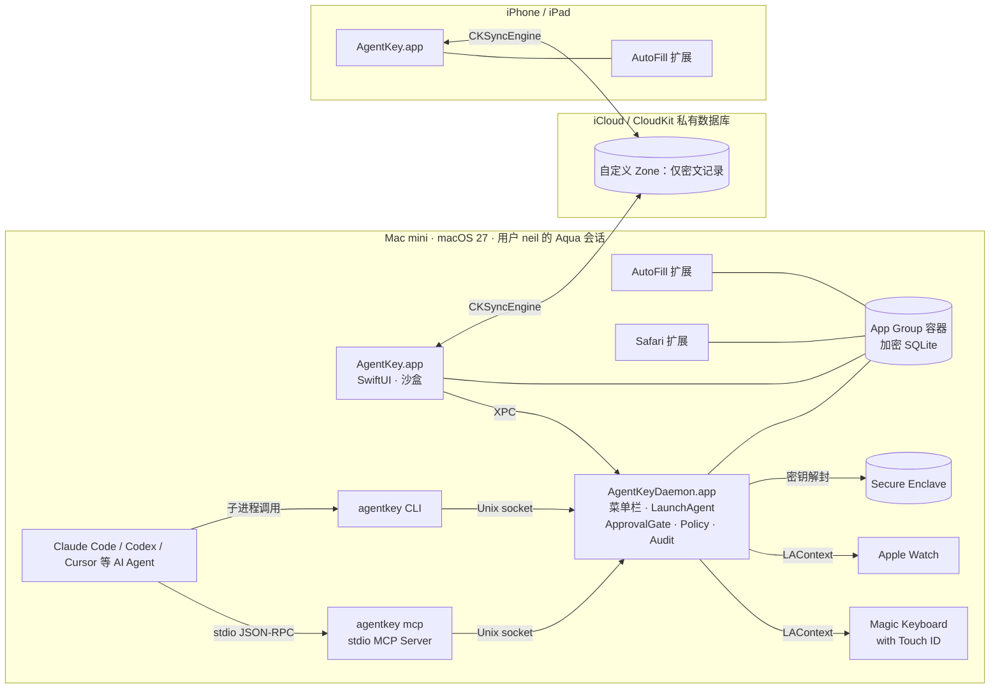
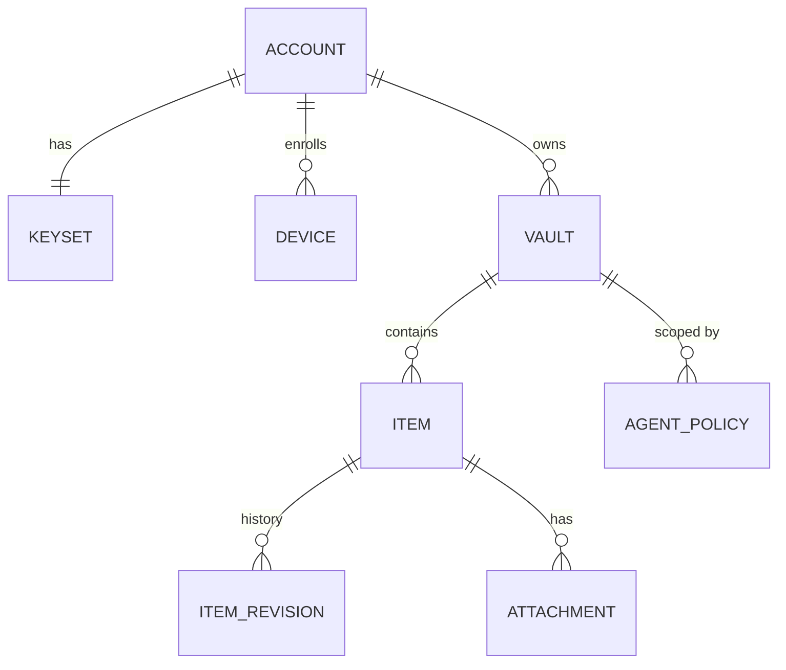
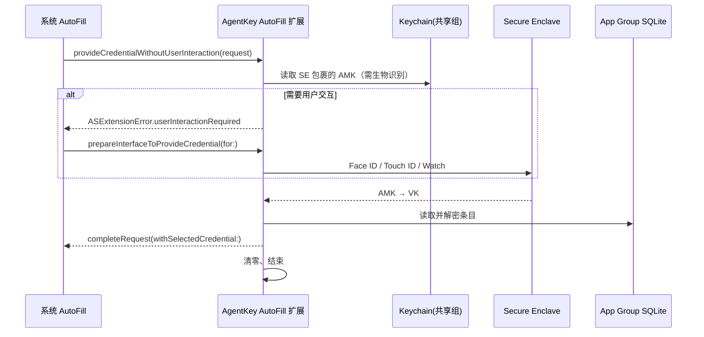
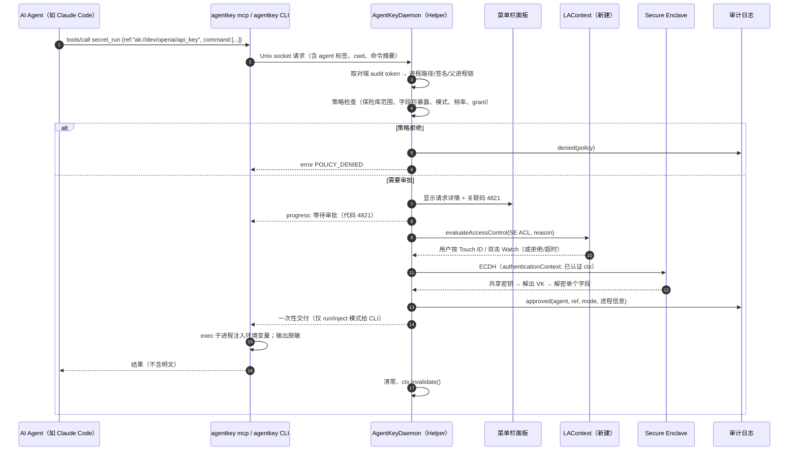

# AgentKey 设计文档

> **人和 Agent 都是一等用户的个人密码管理器：Mac / iPhone / iPad 全端自动填充，设备之间点对点端到端加密同步（家中 Mac mini 做常在线同步节点，不用任何云和服务器），AI Agent 在 Touch ID / Apple Watch 审批下取用并帮你打理保险库。**
> *A personal password manager for humans and AI agents — AutoFill everywhere on Apple devices, end-to-end encrypted peer-to-peer sync between your own devices (an always-on Mac mini as home node — no cloud, no server), and agents that use and tidy your vault under Touch ID / Apple Watch approval.*

本文 Part A 为当前权威设计（2026-10 修订：双用户模型 + 迁移 + Agent 维护；2026-10-13 再修订：**完全不依赖外部服务**，同步改为家庭节点 + 点对点，iCloud/CloudKit 降为默认关闭的遗留模块）；Part B 为早期方案正文（代号 NVault；其中 iCloud/CloudKit 同步部分已作废），其中的密钥体系、审批服务、AutoFill、Safari、Passkeys 等细节仍然有效，与 Part A 冲突时以 Part A 和代码为准。

---

# Part A：当前设计

## A1. 定位

| 用户 | 主要诉求 | 入口 |
|---|---|---|
| **人（Neil）** | 在任何 App / 网站里一键填充密码、通行密钥（Passkeys）和验证码；快速搜索复制；从 1Password / Apple 密码 / 浏览器无痛迁移 | iOS/iPadOS/macOS AutoFill 凭据提供扩展（含 Passkeys、TOTP）、Safari Web 扩展、（后续）Chrome 扩展、macOS 菜单栏快速搜索、iPhone/iPad/Mac App |
| **AI Agent** | ① **使用**秘密（API Key、登录、验证码）且尽量不看到明文；② **打理**保险库（体检、去重、轮换提醒、整理标签） | `agentkeyd` + `agentkey` CLI + `agentkey-mcp`；所有取用与变更都需你在 Mac 上用 Touch ID 或 Apple Watch 批准 |

原则：

1. **个人、零外部服务**：数据只在你自己的设备上。没有云、没有服务器、没有账号；项目不运营任何后端，也不依赖 iCloud/CloudKit。同步由你家里常开的一台设备（通常是 Mac mini，“家庭节点”）和设备之间直接完成。
2. **每台设备都有完整的加密保险库**，离线可用；同步只是交换密文。
3. **端到端加密**：设备间链路是 Noise 加密信道，里面传的仍是逐条 AES-GCM 密文记录；网络上（局域网、Tailscale/WireGuard）只能看到加密流量。
4. **人是最终决策者**：Agent 可以读取元数据、提出建议，但秘密的每次释放、保险库的每次变更都要人确认（生物识别），可部分批准、可撤销、全部审计。
5. **Agent 默认看不到明文**：`run`（注入子进程）/`totp`/`http`（规划中）优先，`reveal` 默认关闭；导入的条目默认不对 Agent 开放。

## A2. 架构

```
┌──────────────── iPhone / iPad ────────────────┐   ┌──────────────────── Mac ────────────────────────────┐
│ AgentKey App (SwiftUI)                         │   │ AgentKey App + 菜单栏快速搜索                         │
│ AutoFill Credential Provider 扩展               │   │ AutoFill 扩展 · Safari Web 扩展 ·（后续）Chrome 扩展     │
│   密码 / Passkeys / TOTP                        │   │ agentkeyd (LaunchAgent, Aqua 会话)                    │
│                                                │   │   ├─ ApprovalGate：Touch ID 或 Apple Watch            │
│                                                │   │   ├─ 策略引擎、审计（哈希链 + HMAC）                    │
│                                                │   │   └─ 健康分析 / 清理计划执行                            │
│                                                │   │ agentkey CLI · agentkey-mcp  ←── AI Agent              │
└───────────────┬────────────────────────────────┘   └───────────────┬────────────────────────────────────┘
                │            AgentKeyCore（共享 Swift Package，跨平台，Linux 上可测）            │
                │  密钥体系 · 条目模型 · 加密记录存储 · 3-way 合并 · 导入器 · 健康分析 · TOTP · 生成器  │
                ▼                                                                      ▼
        本地加密记录库（每条记录 AES-256-GCM）  ⇄  P2P 同步（Noise XX 信道）  ⇄  家庭节点 Mac mini（agentkeyd --sync-node）
                 传输可插拔：Bonjour _agentkey._tcp（局域网）· TCP over Tailscale/WireGuard（外出）· 可选 Multipeer
```

App、扩展、守护进程通过 App Group 共享同一个加密记录库；扩展只做读取（AutoFill 填充后通过共享队列回写 `lastUsedAt`）。

## A3. 密钥体系（沿用 Part B §4，已实现部分）

- AUK = KDF(主密码) ⊕ HKDF-SHA256(Secret Key, salt=accountID, info="agentkey/2skd/v1")。KDF 现为 PBKDF2-HMAC-SHA256 600k（`PasswordKDF` 抽象），Phase 2 换 Argon2id（m=128 MiB, t=3, p=4；扩展内不跑 Argon2，走 Secure Enclave 快速解锁）。
- AUK 解封保险库密钥 VK；VK 派生子密钥：`audit`（审计 HMAC）、`health`（健康分析的密码分组 HMAC）、`record`（同步记录，带 keyVersion 以支持轮换）。
- Secret Key：128 位，`A1-` + Crockford Base32 + 校验位，仅存本机钥匙串（ThisDeviceOnly，不进 iCloud 钥匙串）。新设备加入同步组时不需要 Secret Key：配对握手把同步密钥加密交给它（见 A5.3）；Secret Key 仍保护每台设备本地的保险库文件（离线备份用单独的备份口令，见 A5.7）。

## A4. 本地存储：加密记录库（替代 v0.1 的单文件 JSON 信封）

v0.1 使用一个 JSON 信封文件（`vault.akv`），便于原型；Phase 2 起改为 **SQLite 记录库**（App Group 容器内，`NSFileProtectionComplete` / Data Protection），设计为与同步记录 `SyncRecord` 一一对应：

```sql
CREATE TABLE meta(key TEXT PRIMARY KEY, value BLOB);          -- accountID, kdf 参数, wrappedVK, deviceID, lamport, engineState
CREATE TABLE records(
  id          TEXT PRIMARY KEY,      -- UUID = CKRecord.recordName
  revision    INTEGER NOT NULL,      -- 本地编辑计数
  lamport     INTEGER NOT NULL,      -- Lamport 时钟
  device      TEXT    NOT NULL,      -- 最后写入的设备
  deleted     INTEGER NOT NULL DEFAULT 0,   -- 墓碑
  key_version INTEGER NOT NULL,
  ct          BLOB,                  -- AES-256-GCM(VK_record, item JSON, AAD="agentkey/record|<id>|k<kv>")；墓碑为 NULL
  pending     INTEGER NOT NULL DEFAULT 0,   -- 待上传
  seq         INTEGER NOT NULL       -- 本机变更序号（作为同步 hub 时供对端增量拉取）
);
CREATE TABLE bases(                  -- 3-way 合并基线：每个对端各自一份（最后一次与该对端一致的版本）
  peer TEXT, id TEXT, PRIMARY KEY(peer, id), lamport INTEGER, device TEXT, deleted INTEGER, ct BLOB);
CREATE TABLE search_index(           -- 加密的搜索索引（标题/域名 token 的 HMAC），供 AutoFill 快速匹配
  token_mac BLOB, id TEXT);
```

- **每条记录单独加密**（AES-GCM，AAD 绑定记录 ID 和密钥版本），整库不需要 SQLCipher；元数据列只含非敏感信息。
- 写入流程：`lamport += 1` → 生成新 `revision` → 加密 → `pending=1` → 通知同步引擎。
- 删除 = 写墓碑（`deleted=1, ct=NULL`），墓碑保留 ≥ 90 天后再真正清除（保证离线设备能收到删除）；条目层面另有"废纸篓"（`trashedAt`，可恢复，默认 30 天后由健康分析建议清除）。
- 历史：条目内部保存最近 20 次被替换的秘密值（加密在条目内），用于合并冲突、清理计划与轮换的撤销。
- 代码现状：`SyncRecord` / `RecordMeta` / `Stamp` / `SyncReplica`（内存参考实现）已实现并测试；SQLite 实现是 Phase 2 工作，必须通过与 `SyncReplica` 相同的测试。

## A5. 同步：家庭节点 + 点对点（不用任何外部服务）

> 代码：`Sources/AgentKeyCore/P2P/`（`Noise.swift`、`Transport.swift`、`Identity.swift`、`PeerReplica.swift`、`SyncSession.swift`、`SyncNode.swift`、`Backup.swift`、`AppleTransports.swift`）。
> 纯 Swift 部分（协议、握手、会话状态机、配对载荷、备份格式、内存 + TCP 传输）在 Linux 上构建并测试；Network.framework / Bonjour / Multipeer 在 `#if canImport` 之后，标 `TODO(mac)`。
> 旧的 CloudKit 适配器保留为**遗留可选模块**，默认不编译（需 `-DAGENTKEY_LEGACY_CLOUDKIT`）。

### A5.1 拓扑

- **家庭节点（home node）**：一台常开的自有设备（推荐 Mac mini），运行 `agentkeyd --sync-node`，监听 TCP 7373（局域网 + Tailscale/WireGuard），并通过 NWListener 在局域网广播 Bonjour `_agentkey._tcp`（独立端口；实例名 `agentkey-<指纹前 8 位>`，TXT 只有 `v` 协议版本与 `fp` 短指纹，不泄露设备名 / 保险库信息；`--no-bonjour` 或 `AGENTKEY_NO_BONJOUR=1` 关闭）。客户端用 NWBrowser 发现（`agentkey sync discover`），按短指纹与已配对设备对应后记住 `bonjour:<名字>` 端点，下次优先使用，失败回退 `host:port`。发现只是寻址，信任锚仍是 Noise 握手中钉住的完整指纹。它和其它设备一样持有完整副本，只是“总在线”。
- **其它设备**（MacBook、iPhone、iPad）：作为客户端连家庭节点同步（`agentkey sync now`，守护进程每 5 分钟后台同步一次）。协议本身是对称的：任何副本都能当 hub，所以两台设备在没有家庭节点时也可以直接互相同步（例如 Multipeer）。
- 没有中继、没有账号、没有云。外出时用你自己的 Tailscale / WireGuard 回家；连不上就离线工作，回家后再收敛。

### A5.2 设备身份

- 每台设备一个 **Curve25519 静态密钥**（`DeviceIdentity`）和随机 deviceID。指纹 = Base32(SHA-256("agentkey-fp/1" ‖ pub)[0..20])，分组显示，如 `QVSD-7OYQ-KWZD-…`。
- 存储：TODO(mac) 钥匙串 ThisDeviceOnly，并用 **Secure Enclave 的 P-256 密钥包裹**（SE 不支持 X25519，所以由 SE 密钥加密保护 X25519 私钥）；Linux / 开发机上是 0600 文件。
- **TrustState**（设备注册表 + 密钥环）在同步组里复制，按半格合并：设备集合取并集，`revokedAt` 一旦设置就**永久生效**（撤销是粘性的，旧状态无法“取消撤销”）。

### A5.3 配对（二维码）

1. 家庭节点上 `agentkey device pair`（需 Touch ID / Watch 批准）生成一次性载荷 `agentkey-pair:<base64url>`（显示为二维码）：`{vaultID, nodeName, hosts[]（优先 `bonjour:<名字>`，再是 IP / Tailscale 名）, port, fingerprint(节点公钥), secret(32 字节一次性), expires(默认 10 分钟)}`。
2. 新设备扫码 / 粘贴：`agentkey device pair <code>`（同样需批准）。双方跑 **Noise_XX_25519_ChaChaPoly_SHA256 + psk**（一次性 secret 通过 mixKeyAndHash 混入，prologue 绑定 `agentkey-pair/1|vaultID`），实现**双向认证**：
   - 新设备在发送自己的身份（msg3）**之前**校验对端静态公钥指纹 == 二维码里的指纹，不符即中止（防 MITM / 冒充节点）；
   - 节点要求对方知道一次性 secret（psk 不对握手直接失败），载荷**单次使用**（无论成败都作废）且有过期时间。
3. 节点把新设备加入 TrustState，并用 **KeyWrap**（临时 X25519 + HKDF + ChaChaPoly，绑定 `vaultID|keyVersion`）为它包裹每个同步密钥版本；整个 **handover**（TrustState + 密钥）在已认证的 Noise 信道里发送。
4. 新设备之后用普通同步协议拉全量数据；本地保险库与副本之间通过 **VaultBridge** 双向对账（HMAC 快照，不落明文）。

### A5.4 安全信道

- 同步连接也是 **Noise XX**（prologue `agentkey-sync/1|vaultID`），握手后双方都检查对端公钥在 TrustState 中且**未被撤销**，否则断开（fail-closed）。客户端额外钉住目标设备的指纹。
- 传输阶段：ChaChaPoly + 递增 64 位计数器 nonce，**重放 / 乱序 / 篡改的帧都会解密失败**并终止会话；每次会话新的临时密钥 → **前向保密**。
- 首帧是明文模式标签（pair / sync），同时也写进 prologue，被篡改会导致握手失败。帧格式 4 字节长度前缀，最大 8 MiB。

### A5.5 同步协议（与传输无关）

在已有 `MergeEngine` / `SyncRecord` 基础上：

- 每个副本给本地每次变更编号 `seq`（单调递增）。客户端为每个 hub 保存 `cursor[hub]`（已应用到的 hub seq）。
- 会话：`hello(since=cursor, trust)` → hub 回若干页 `delta(trust, records>since, upTo, more)` → 客户端**整页应用后**才推进 cursor（可恢复、幂等：中断后重来不会丢也不会重复）→ 客户端 `push(records + 各自的 CAS 基线)` → hub 对每条做**比较并交换**：基线等于 hub 当前版本则接受，否则回传 hub 版本作为冲突 → 客户端用 `MergeEngine` 三方合并后再推（最多 8 轮）→ `done(hubSeq)`。
- 每个对端各自维护合并基线（per-peer base），因此三方合并在多设备下仍然确定。hub 端会话串行化。
- 线上只有：Noise 加密帧，里面是 `SyncRecord`（逐条 AES-GCM 密文，AAD = `agentkey/record|id|k<keyVersion>`）+ 非敏感元数据（Lamport、设备 ID、删除标记、密钥版本）+ TrustState（公钥、名字、包裹后的密钥）。
- 合并语义不变：逐属性三方合并、集合合并、删除 vs 编辑保留编辑、落败的秘密值进条目历史。
- 测试（`P2PTests`、`SyncNodeTests`）：握手成功 / psk 不符 / 指纹不符 / 中间人篡改 / 重放；3 设备经真实协议（内存传输）收敛；同字段冲突确定性收敛；TCP 回环分页同步；撤销；副本落盘无明文；节点 + 两份真实保险库文件经 TCP 配对并双向同步；一次性配对码不可复用。

### A5.6 撤销与密钥轮换

- `agentkey device revoke <设备>`（需批准）：在 TrustState 里标记撤销（粘性），**立即轮换同步密钥**（新 keyVersion = (代数<<32)|随机），新密钥只包裹给仍受信任的设备；所有现存记录用新密钥重新加密并重新打戳，随下次同步扩散。
- 被撤销设备：所有节点在握手阶段拒绝它；即使拿到新记录也解不开。**它已经解密过的数据无法收回**——撤销后应轮换它可能见过的密码（健康分析会提示）。

### A5.7 加密离线备份

- `agentkey backup export <file>`（需批准）：`.akbackup` = JSON 头 `{format, version, createdAt, createdBy, itemCount, kdf}` + AES-256-GCM 密文；密钥 = PBKDF2-SHA256(600k, 备份口令 ≥ 12 字符)；**AAD 覆盖头部字段**，改头即失败。
- `agentkey backup restore <file>`（需批准）：口令错误 / 文件被改 → 拒绝；按条目 ID 合并（不存在则新增，备份更新则覆盖）。
- 备份是脱离所有设备和网络的最后防线（家里失火、全部设备丢失）。

### A5.8 威胁模型（同步部分）

| 威胁 | 后果 | 对策 / 残余风险 |
|---|---|---|
| **设备丢失 / 被盗** | 攻击者拿到一台已配对设备 | 本地保险库需主密码 + Secret Key；同步副本用设备身份派生密钥加密（Mac 上 TODO 由 SE/钥匙串保护）。用其它设备 `device revoke` → 握手拒绝 + 密钥轮换；之后的新数据它解不开。残余：设备在解锁状态被拿走时已缓存的数据；撤销后轮换重要密码。 |
| **配对时中间人** | 冒充家庭节点骗新设备入组，或冒充新设备 | 二维码带节点公钥指纹，新设备在暴露身份前校验；一次性 32 字节 secret 作 Noise psk，不知道就无法完成握手；单次使用 + 10 分钟过期；配对两端都需要生物识别批准。残余：二维码被人拍到并抢先使用 → 合法设备配对失败（单次使用）即可察觉，在节点上 `device list` 核对后撤销。 |
| **局域网 / 公网窃听、重放、篡改** | 读取或伪造同步流量 | Noise 加密 + 认证；计数器 nonce 拒绝重放；临时密钥前向保密；Bonjour 结果只是提示，仍需指纹匹配。 |
| **家庭节点被攻破** | 节点持有全部同步密钥和副本 | 节点和你的 Mac 一样敏感：开 FileVault、仅你的账户、强登录密码、保持系统更新、不对公网开放端口（用 Tailscale/WireGuard）。节点无法绕过其它设备的生物识别审批去释放秘密给 Agent，也不能取消撤销；被攻破后从另一台设备撤销它，选一台新节点重新配对。残余：被攻破期间的数据视为泄露。 |
| **被撤销设备重放旧 TrustState** | 试图“取消撤销” | 撤销粘性合并，旧状态不能覆盖。 |
| **恶意已配对设备** | 推送垃圾或删除 | 删除只是墓碑 + 历史可恢复；审计记录来源设备；撤销该设备。 |
| **备份文件泄露** | 离线暴力破解 | PBKDF2 600k + 口令长度下限；建议用生成的长口令单独保存。 |

### A5.9 遗留：CloudKit（默认关闭）

`CloudKitSyncAdapter.swift` 仅在 Apple 平台且编译标志 `AGENTKEY_LEGACY_CLOUDKIT` 打开时编译，未验证、不在路线图内。默认构建不包含任何云组件。

## A6. 迁移导入（`Importers`，已实现）

| 来源 | 格式 | 说明 |
|---|---|---|
| 1Password | `.1pux`（ZIP 内 `export.data` JSON） | 登录、密码、安全笔记、API 凭据；TOTP（sections 中 `totp`）；自定义字段；标签、归档、非个人保险库名作为标签；跳过废纸篓；附件与通行密钥提示未导入 |
| 1Password | CSV | Title, Url, Username, Password, OTPAuth, Favorite, Archived, Tags, Notes |
| Apple 密码 / iCloud 钥匙串 | CSV | Title, URL, Username, Password, Notes, OTPAuth |
| Chrome / Edge / Brave / Arc | CSV | name, url, username, password, note |
| Firefox | CSV | url, username, password, …（跳过 `chrome://` 内部条目，标题取域名） |
| Bitwarden | JSON（未加密）/ CSV | 登录、安全笔记、自定义字段、文件夹→标签、多 URI；卡片 / 身份 / SSH 暂不支持并报告 |
| 通用 CSV | 自动识别常见列名，`--map title=…,password=…` 自定义 | 支持 `,` `;` Tab 分隔、BOM、多行字段 |

- TOTP：`otpauth://` 解析并规范化（发行方、账户、算法、位数、周期）；裸 Base32 也接受；Steam 等非标准格式警告并跳过该字段。
- 去重：登录按「规范化主机 + 用户名 + SHA-256(密码‖TOTP)」，其他按类型 + 标题 + 内容摘要；文件内重复和已在保险库中的都会跳过并报告。
- `ImportReport`：来源总数、导入数（按类型）、含 TOTP 数、重复数、跳过列表（序号、标题、原因）、警告。
- **明文绝不落盘**：导入文件只读入内存（ZIP 也在内存中解压，纯 Swift inflate + CRC 校验）；完成后提示用户安全删除导出文件。
- 导入的条目 `agentModes = []`：Agent 默认无权取用，需人逐条开启。
- CLI：`agentkey import <auto|格式> <文件> [--dry-run] [--map …] [--json]`；App 里将提供同等的导入向导。

## A7. Agent 维护保险库（AI-Native Hygiene）

**目标**：Agent 不只是取秘密，还能当"保险库管家"——但它**只能看到元数据、只能提建议**，执行必须由人批准。

### A7.1 健康分析（`VaultHealth`，已实现）

在可信进程（`agentkeyd` / App）内计算，Agent 只拿到发现项：

| 发现 | 判定 | 隐私处理 |
|---|---|---|
| `reused_password` | 多个条目秘密相同 | 按 `HMAC(VK_health, 密码)` 分组，输出的 groupID 只是 HMAC 前缀，换保险库即不同，不能离线比对 |
| `weak_password` | 常见密码表 / 长度 < 12 / 估算熵 < 60 bit | 只输出熵、长度 |
| `duplicate_entry` | 同主机 + 同用户名 | — |
| `stale_item` | `lastUsedAt` 与 `updatedAt` 都早于 N 天（默认 365） | AutoFill 和 Agent 取用都会更新 `lastUsedAt` |
| `password_not_rotated` | `passwordChangedAt` 早于 N 天（默认 730） | 修改主秘密时自动记录 |
| `missing_totp` | 站点支持验证器 2FA 但未存 TOTP | 目前为内置小名单（TODO：2fa.directory 数据） |
| `trash_not_purged` | 在废纸篓超过 30 天 | — |

输出含 0–100 分、分类计数、按严重度排序的发现（条目 ID、`ak://` 引用、说明、指标）。

### A7.2 清理计划（`CleanupPlan`，已实现）

- Agent 通过 MCP `propose_cleanup` / CLI `agentkey plan create` 创建结构化计划；不传动作时由健康报告自动推导。
- 动作：`merge`（保留最近使用的一条，合并 URL / 标签 / 备注 / 缺失字段，差异秘密进历史，其余移入废纸篓并打 `merged` 标签）、`trash`、`archive`、`restore`、`flag_rotation`（打 `rotate` 标签）、`add_tags`、`remove_tags`、`purge`（只能清除已在废纸篓的条目）。
- 校验：未知条目、合并缺 keep、purge 未入废纸篓的条目、重复动作 ID 等一律拒绝。
- 计划只存条目 ID 和原因（`plans/<id>.json`，0600），不含秘密。
- **执行只能由人**：`agentkey plan apply <id> [--actions a1,a3]` → `agentkeyd` 弹出 Touch ID / Apple Watch 确认（文案含动作数、计划 ID、提出者、关联码）→ 支持整体或部分批准 → 每个动作写审计 → 计划状态 `applied / partially_applied / rejected`。MCP 不提供 apply 工具。
- 可逆：除 `purge` 外所有动作都可通过 `restore` 计划撤销，被替换的秘密值保存在条目历史中。

### A7.3 轮换助手（路线图）

1. Agent 根据 `flag_rotation` 列表逐个生成新密码（站点规则可配置）；
2. 人在网站上修改密码（后续可由 computer-use Agent 在人监督下操作）；
3. Agent 通过 `rotate_secret` 提交新值 → Touch ID / Watch 批准后写入，旧值进历史，`passwordChangedAt` 更新，`rotate` 标签移除。

## A8. 人用体验（规划）

- **AutoFill 凭据提供扩展**（iOS/iPadOS/macOS）：密码、Passkeys（作为提供者，ES256 软件密钥以便同步）、TOTP 一次性码；`ASCredentialIdentityStore` 维护身份索引；扩展内用 Secure Enclave 快速解锁。
- **Safari Web 扩展**：网页内识别登录表单、保存新密码、生成密码；与 App 通过 native messaging。
- **Chrome 扩展**（后续）：同一套 Web 扩展代码，native messaging host 连 `agentkeyd`（需人确认）。
- **菜单栏快速搜索**（macOS）：⌥⌘\ 呼出，模糊搜索，复制用户名 / 密码 / 验证码（剪贴板 30 秒清除）。
- **iPhone / iPad App**：浏览、编辑、导入向导、健康报告、审批 Agent 计划。

## A9. 路线图

| 阶段 | 内容 | 状态 |
|---|---|---|
| **Phase 1 — Mac 核心 + Agent 通道** | AgentKeyCore（2SKD、逐条加密、TOTP、生成器）、`agentkeyd` + Touch ID/Watch 审批、CLI、MCP、审计、`--json`、输出脱敏 | ✅ v0.1（Mac 实测中） |
| **Phase 1.5 — 迁移 + Agent 维护 + 同步模型** | 导入器（1Password/Apple/Chrome/Firefox/Bitwarden/CSV）、健康分析、清理计划、Lamport + 墓碑 + 三方合并 | ✅ |
| **Phase 1.6 — 零外部服务同步** | Noise XX 信道、设备身份、二维码配对、家庭节点 `agentkeyd --sync-node`、P2P 增量同步、撤销 + 密钥轮换、加密离线备份、`device`/`sync`/`backup` 命令；CloudKit 降为默认关闭的遗留模块 | ✅ Linux 测试通过；Bonjour/NW 传输、SE 包裹身份密钥待 Mac 验证 |
| **Phase 2 — 存储 + 同步落地** | SQLite 加密记录库、Bonjour 自动发现 + Multipeer、iOS 后台同步、二维码扫描 UI、Argon2id、Secure Enclave 快速解锁、签名 App + App Group + 钥匙串 ACL | ⏳ |
| **Phase 3 — 全端人用体验** | iPhone / iPad / Mac App、AutoFill 扩展（密码 + TOTP）、菜单栏快速搜索、导入向导 | ⏳ |
| **Phase 4 — Passkeys + 浏览器** | Passkeys 提供者、Safari Web 扩展、Chrome 扩展（native messaging） | ⏳ |
| **Phase 5 — 高级 Agent 能力** | 轮换助手、`http` / `inject` / `fill` 模式、授权（grants）与撤销、iPhone 远程审批、HPKE 加密审计 | ⏳ |

---

# Part B：早期方案正文（NVault，已改名）

> 已做命名替换：NVault→AgentKey，`nvault`→`agentkey`，`nv://`→`ak://`，`com.neilxu.nvault`→`com.neardws.agentkey`。§6（本地存储）、§7（同步）、§16（路线图）已被 Part A 的 A4、A5、A9 取代。

> 与 §0 冲突之处以 §0 和代码为准。

# AgentKey 技术设计文档 —— Neil Xu 个人密码管理器（类 1Password）

| 项目 | 内容 |
|---|---|
| 文档版本 | v0.1（草案） |
| 日期 | 2026-10-13 |
| 作者 / 使用者 | Neil Xu（单用户、个人使用） |
| 代号 | **AgentKey**（CLI：`agentkey`，Bundle ID 前缀：`com.neardws.agentkey`，Team ID 以 `TEAMID` 占位） |
| 平台 | macOS 27（Mac mini，主力 + Agent 宿主）、iOS / iPadOS（版本以 Xcode 26.2 SDK 为准） |
| 工具链 | Xcode 26.2、Swift 6.2（严格并发）、SwiftUI 多平台目标 |
| 已有资产 | `/workspace/agent-secrets/ApprovalGate.swift`（Touch ID / Apple Watch 审批门，已整合进本文第 11 节） |

> 说明：本文中标注 **【需实机验证】** 的条目是依赖较新 SDK 行为、或 Apple 文档描述不够明确的地方，必须在 Phase 1 的技术验证（Spike）中在 Mac mini 上实测确认，不能仅凭文档假设。

---

## 目录

1. 目标与非目标
2. 系统总览与架构
3. 威胁模型
4. 密钥体系（主密码 + Secret Key、Argon2id、Secure Enclave）
5. 保险库数据模型
6. 本地存储与内存安全
7. iCloud（CloudKit）同步、端到端加密与冲突解决
8. AutoFill 凭据提供扩展（Credential Provider Extension）
9. Safari Web 扩展
10. Passkeys 与 TOTP
11. AI Agent 访问：审批服务（整合 ApprovalGate.swift）
12. Agent API 规范（CLI、本地 IPC 协议、MCP 工具定义）
13. 审计日志
14. 备份与恢复
15. Xcode 工程结构、签名与权限（Entitlements）
16. 分阶段 MVP 路线图
17. 风险与待决问题
18. 附录

---

## 1. 目标与非目标

### 1.1 目标

- **G1 原生体验**：SwiftUI 多平台 App，覆盖 Mac、iPhone、iPad；界面风格接近 1Password（侧边栏保险库 → 条目列表 → 详情）。
- **G2 零知识同步**：通过 Neil 自己的 iCloud 私有数据库（CloudKit）同步；所有敏感内容在客户端加密，Apple / iCloud 只看到密文与少量元数据。
- **G3 强认证**：主密码 + 128 位 Secret Key 双因子派生（2SKD，参考 1Password 设计），Argon2id 抗暴力破解；设备本地用 Secure Enclave 做快速解锁。
- **G4 系统集成**：AutoFill 凭据提供扩展（密码、Passkey、验证码）、Safari 扩展、TOTP。
- **G5 AI Agent 可调用**：Mac mini 上常驻的每用户 LaunchAgent / 菜单栏服务，提供 CLI 与 MCP Server（Unix socket / XPC）。**每一次**密钥释放都需要 Neil 在 Magic Keyboard 的 Touch ID 上按指纹，或双击 Apple Watch 侧边按钮确认；默认**失败即拒绝（fail closed）**、**无密码回退**。
- **G6 最小暴露**：优先使用"注入 / 填充"模式（环境变量注入运行、模板注入、代理 HTTP 请求），让明文尽量不进入 Agent 的上下文 / 对话记录。
- **G7 可审计**：每次请求（批准、拒绝、超时、出错）都写入防篡改的审计日志。

### 1.2 非目标

- 多用户 / 家庭 / 团队共享（数据模型预留 `vault.ownerKind`，但不实现）。
- Android、Windows、Web 版。
- 防御已获取 root / 内核权限的攻击者，或在设备已解锁状态下的物理胁迫。
- 自建服务器；只使用 CloudKit。

### 1.3 关键设计原则

1. **硬件强制优于代码检查**：能由 Secure Enclave 强制执行的（生物识别门控），就不只依赖 App 内的 `if` 判断。
2. **默认拒绝**：没有可用审批器（Touch ID 键盘未连接、Watch 不在身边）、屏幕锁定、非交互会话 → 一律拒绝。
3. **最小信任 Agent**：把 Agent 视为"可能已被提示注入（prompt injection）的不可信调用方"。
4. **显式胜于便利**：短期授权（grant）是显式开关，默认关闭；默认粒度是"一次请求、一次批准"。

---

## 2. 系统总览与架构

### 2.1 组件

| 组件 | 平台 | 职责 |
|---|---|---|
| **AgentKey.app** | macOS / iOS / iPadOS | 主 App：建账户、解锁、条目增删改、设置、同步、导入导出 |
| **AgentKeyCore**（Swift Package） | 全平台 | 加密、数据模型、存储、同步引擎、策略、TOTP、Passkey 逻辑 |
| **AutoFill 扩展** | iOS / macOS（两个 target） | 密码、Passkey、一次性验证码的系统级自动填充 |
| **Safari Web 扩展** | macOS / iOS | 非标准表单填充、密码生成、页面内 UI（后期） |
| **AgentKeyDaemon.app**（菜单栏助手） | 仅 macOS | 常驻 LaunchAgent；持有审批门、IPC 服务、审计；`LSUIElement` 菜单栏图标 |
| **agentkey**（CLI） | 仅 macOS | Agent 与人使用的命令行；同时是 MCP stdio Server（`agentkey mcp`） |

### 2.2 架构图



### 2.3 进程与信任边界

- **边界 A（设备 ↔ iCloud）**：只出密文。CloudKit 被视为不可信存储。
- **边界 B（Agent ↔ Helper）**：Agent、MCP Server、CLI 都运行在 Neil 的用户身份下，**不可信**。Helper 是唯一能触发密钥解封的进程，且解封需要硬件生物识别。
- **边界 C（Helper ↔ Secure Enclave）**：用于"Agent 可访问保险库"的解封私钥在 SE 中，其访问控制 `[.privateKeyUsage, .biometryCurrentSet, .or, .companion]` 由 SE / 系统强制。
- **边界 D（App ↔ 扩展）**：通过 App Group 容器 + 共享 Keychain 访问组共享数据；扩展不做 Argon2id，只走 SE 快速解锁。

---

## 3. 威胁模型

### 3.1 资产

| 资产 | 敏感度 | 说明 |
|---|---|---|
| 主密码 | 最高 | 只存在于 Neil 脑中；内存中仅短暂存在 |
| Secret Key（128 位） | 最高 | 本地 Keychain（ThisDeviceOnly）+ 紧急备份卡（纸质） |
| 账户主密钥 AMK / 保险库密钥 VK | 最高 | 只以被包裹（wrapped）的形式落盘 |
| 条目明文（密码、API Key、SSH 私钥、Passkey 私钥、TOTP 种子） | 高 | |
| 条目元数据（标题、URL、标签） | 中 | 同样加密（overview 层），但 Agent 列表可按策略访问 |
| 审计日志 | 中 | 需完整性，必要时可读 |

### 3.2 攻击者与对策

| # | 攻击者 / 场景 | 能力 | 主要对策 |
|---|---|---|---|
| T1 | iCloud / Apple 服务端被攻破、法律调取 | 读取全部 CloudKit 记录 | 客户端 AES-256-GCM 加密；2SKD 使离线暴力破解需要 Secret Key；记录名、Zone 名随机化 |
| T2 | 网络攻击者 | 中间人 | CloudKit TLS + 应用层加密 + AEAD 完整性 |
| T3 | 设备丢失 / 被盗（锁定状态） | 物理持有 | 数据保护级别 `WhenUnlockedThisDeviceOnly`；SE 密钥不可导出；Argon2id 拖慢暴力破解 |
| T4 | **被提示注入的 AI Agent** | 以 Neil 身份发起任意 MCP / CLI 请求，伪造 Agent 名称 | 每次请求硬件审批；提示框显示 Agent + 密钥名 + 进程信息；保险库范围限定；默认禁用明文 reveal；HTTP 模式绑定目标主机；频率限制与异常自动锁定 |
| T5 | 同用户恶意软件 | 读同用户文件、连 socket、`ptrace` 未加固进程、读其它进程环境变量 | Helper 启用 Hardened Runtime（禁 `get-task-allow`、禁调试附加）；解封需 SE + 生物识别；明确承认：已注入到子进程环境变量的明文对同用户恶意软件可见（见 17 节） |
| T6 | 审批提示伪造 / 混淆 | 构造误导性 Agent 名或密钥名（Unicode 双向字符、换行、超长） | 名称清洗与截断；以 Helper 注册表中的名称为准而非客户端自报；每个请求生成 4 位关联码，同时显示在 CLI 输出与菜单栏面板 |
| T7 | 审批疲劳（狂按指纹） | 大量请求诱导习惯性批准 | 频率限制；同一请求去重；连续拒绝后冷却；菜单栏面板显示完整上下文；夜间/锁屏一律拒绝 |
| T8 | 钓鱼网站 | 诱导 AutoFill 到相似域名 | 严格 eTLD+1（Public Suffix List）匹配 + 系统提供的 serviceIdentifier；Passkey 天然防钓鱼 |
| T9 | 供应链 | 恶意依赖 | 依赖最少化（Argon2 参考实现以源码 vendoring + 校验哈希）；不引入网络类第三方库 |
| T10 | Neil 自己忘记主密码 / 丢失全部设备 | 自损 | 紧急备份卡、离线加密备份、恢复码（第 14 节） |
| T11 | 肩窥 / 录屏 | 看到明文 | 默认遮罩；剪贴板 30 秒清除并标记 `org.nspasteboard.ConcealedType`；隐藏于屏幕共享（`NSWindow.sharingType = .none`） |

### 3.3 不在范围内

- root / 内核级恶意软件、已越狱 / 关闭 SIP 的设备。
- Apple 平台本身（Secure Enclave、LocalAuthentication、CloudKit 客户端）的漏洞。
- Neil 在知情情况下批准了恶意请求（我们只能尽量让他"看得清"）。

### 3.4 安全不变量（必须由测试覆盖）

1. 任何明文条目内容、AMK、VK 永不以明文写入 CloudKit 或磁盘。
2. Agent 路径上的每一次密钥释放，都对应一次成功的 SE 门控操作 + 一条审计记录。
3. 审批器不可用时，Agent 请求返回错误，不会降级为密码或自动批准（除非 Neil 在设置中显式开启且该设置变更本身需要生物识别确认）。
4. `LAContext` 每次请求新建，`touchIDAuthenticationAllowableReuseDuration = 0`，用后 `invalidate()`。

---

## 4. 密钥体系

### 4.1 总览

```
主密码 (人记忆)            Secret Key (128 bit, 设备生成, "A3-XXXXXX-...")
     │ NFKD 规范化 + trim             │
     ▼                                ▼
Argon2id(salt_acct, m,t,p) → K1   HKDF-SHA256(SecretKey, salt=accountID,
     │                                info="agentkey/2skd/v1") → K2
     └──────────────┬─────────────────┘
                    ▼
            AUK = K1 ⊕ K2   (Account Unlock Key, 256 bit, 仅内存)
                    │ AES-256-GCM 解封
                    ▼
     Keyset { AMK (Account Master Key, 256 bit), keysetVersion }
                    │ 解封
       ┌────────────┼──────────────────┬───────────────────┐
       ▼            ▼                  ▼                   ▼
   VK_personal   VK_agent-dev     OVK (overview key)   AuditKey (HPKE 私钥)
   (保险库密钥)  (Agent 可用保险库)   (元数据层)          (审计日志解密)
       │            │
       ▼            ▼
   条目 details / overview：AES-256-GCM(VK, nonce, AAD)
```

设备侧快速解锁（不用每次输入主密码）：

```
Secure Enclave P-256 KeyAgreement 私钥 (每设备生成、不可导出)
   └─ ECIES(ephemeral P-256 ECDH → HKDF → AES-GCM) 包裹 AMK
        → 存于本机 Keychain（kSecAttrAccessibleWhenUnlockedThisDeviceOnly，共享访问组）
```

Agent 审批专用路径（第 11 节详述）：

```
SE 私钥 "agent-release"，ACL = [.privateKeyUsage, .biometryCurrentSet, .or, .companion]
   └─ ECIES 包裹 VK_agent-*（仅限 Agent 范围的保险库密钥）
每次请求：新 LAContext → evaluateAccessControl(Touch ID 或 Watch) → 用该 context 做 ECDH
→ 解出 VK → 解密单个条目 → 立即清零
```

### 4.2 参数与算法选择

| 用途 | 算法 | 实现 |
|---|---|---|
| 口令派生 | Argon2id v1.3，输出 32 B | vendored 参考 C 实现（phc-winner-argon2，CC0/Apache-2.0）作为 SwiftPM C target；或 libsodium `crypto_pwhash`（ALG_ARGON2ID13）。CryptoKit 不提供 Argon2 |
| 默认 Argon2id 参数 | m = 128 MiB，t = 3，p = 4 | 在 Mac mini（Apple silicon）目标 ~0.5–1 s；在 iPhone 主 App 内可接受。参数存于账户记录，可升级 |
| Secret Key 混合 | HKDF-SHA256 | CryptoKit `HKDF<SHA256>` |
| 对称加密 | AES-256-GCM（96 位随机 nonce） | CryptoKit `AES.GCM` |
| 设备包裹 | P-256 ECDH + HKDF + AES-GCM | CryptoKit `SecureEnclave.P256.KeyAgreement` |
| 审计加密 | HPKE（DHKEM-X25519, HKDF-SHA256, AES-256-GCM） | CryptoKit `HPKE` |
| 审计链 | HMAC-SHA256 | CryptoKit `HMAC` |
| TOTP | HMAC-SHA1/256/512 | CryptoKit `Insecure.SHA1` 等 |
| Passkey | ES256（P-256） | CryptoKit `P256.Signing`（**软件密钥**，以便同步） |

> 为什么 AutoFill 扩展里不跑 Argon2id：扩展有较严格的内存上限（经验值远低于主 App），128 MiB 的 Argon2id 有被系统杀掉的风险。扩展只用 SE 快速解锁；如设备快速解锁失效（例如指纹集合变化导致 `.biometryCurrentSet` 失效），扩展提示"请打开 AgentKey 主 App 用主密码解锁"。

### 4.3 Secret Key

- 生成：`SecRandomCopyBytes` 128 位（16 B）；编码为 `A3-` + 版本 + 账户 ID 前缀 + Crockford Base32 分组，例如 `A3-NX7K2Q-4M9TZB-...`，带校验位。
- 存储：每台设备本地 Keychain，`kSecAttrAccessibleWhenUnlockedThisDeviceOnly`，**不**进 iCloud Keychain（防止 Apple 账户被攻破时与密文同处一地）。
- 新设备加入：在已登录设备上显示 QR（含 Secret Key + 账户 ID，有效期 5 分钟，扫描后仍需输入主密码）；或手动输入紧急备份卡上的 Secret Key。

### 4.4 账户建立流程

1. 生成 `accountID`（UUIDv4）、`salt_acct`（16 B）、Secret Key。
2. Neil 设定主密码（zxcvbn 风格强度评估，要求 ≥ 4 个随机词或 ≥ 14 字符混合）。
3. 计算 AUK；生成 AMK、OVK、`VK_personal`、审计 HPKE 密钥对。
4. Keyset = AES-GCM(AUK, {AMK}, AAD="keyset|accountID|v1")；其余密钥由 AMK 包裹。
5. 生成紧急备份卡 PDF（第 14 节）。
6. 生成本机 SE 快速解锁密钥并包裹 AMK。
7. 上传 Account 记录（salt、Argon2 参数、加密 Keyset）到 CloudKit。

### 4.5 解锁、锁定与轮换

- **完全解锁**：主密码 + 本机 Secret Key → AUK → Keyset → AMK。
- **快速解锁**：Touch ID / Face ID / Watch（Mac）→ SE 解封 AMK。快速解锁有最长时效（默认 14 天），过期强制输入主密码，避免长期遗忘主密码。
- **自动锁定**：闲置 N 分钟、屏幕锁定、睡眠、快速用户切换 → 主 App 清除内存中的 AMK / VK。
- **主密码修改**：只需重新计算 AUK 并重新包裹 Keyset，条目无需重加密。
- **Secret Key 轮换**：同上（AUK 变化），同时作废旧紧急备份卡。
- **保险库密钥轮换**：生成 `VK v(n+1)`，新写入使用新密钥，后台惰性重加密旧条目；`keyVersion` 字段标识。
- **疑似泄露的"重置账户"**：全部密钥重新生成 + 全量重加密 + CloudKit 旧 Zone 删除。

### 4.6 Secure Enclave 使用要点

- SE 只支持 P-256；用 CryptoKit `SecureEnclave.P256.KeyAgreement.PrivateKey(accessControl:authenticationContext:)` 创建，持久化其 `dataRepresentation`（一个只能被本机 SE 使用的加密 blob）到 Keychain。
- 快速解锁 ACL（Mac）：`[.privateKeyUsage, .biometryCurrentSet, .or, .companion]`；（iOS）：`[.privateKeyUsage, .biometryCurrentSet]`。
- `.companion` 是 macOS 15 起替代已弃用 `.watch` 的标志。**【需实机验证】** SE 密钥 ACL 中 `.or, .companion` 在 macOS 27 上能否由 Apple Watch 双击满足。
- `.biometryCurrentSet`：新增/删除指纹后密钥永久失效 → 需用主密码重新登记（这是期望的安全行为，必须有清晰的恢复 UI）。

---

## 5. 保险库数据模型

### 5.1 实体关系



### 5.2 Swift 模型（AgentKeyCore，明文侧）

```swift
public struct VaultID: Hashable, Codable, Sendable { public let raw: UUID }
public struct ItemID:  Hashable, Codable, Sendable { public let raw: UUID }

public struct Vault: Codable, Sendable {
    public let id: VaultID
    public var name: String                 // 加密存储
    public var icon: String
    public var agentAccess: AgentAccess     // .none（默认） | .scoped(AgentPolicyID)
    public var keyVersion: Int
}

public enum ItemKind: String, Codable, Sendable {
    case login, password, apiCredential, secureNote, sshKey, creditCard,
         identity, totpOnly, passkey, database, server, document
}

/// 列表 / 搜索 / Agent list 使用；与 details 分开加密，可用 OVK 解密
public struct ItemOverview: Codable, Sendable {
    public var title: String
    public var subtitle: String?            // 用户名等
    public var urls: [URLMatch]             // 含匹配规则
    public var tags: [String]
    public var agentRef: String?            // 例如 "ak://dev/openai/api_key" 的 item 段别名
    public var allowedHosts: [String]       // http 注入模式的白名单
    public var hasTOTP: Bool
    public var hasPasskey: Bool
    public var updatedAt: Date
}

/// 真正的秘密；只有 VK 能解
public struct ItemDetails: Codable, Sendable {
    public var fields: [Field]
    public var notes: String?
    public var totp: TOTPConfig?
    public var passkey: PasskeyMaterial?
    public var passwordHistory: [HistoricValue]
}

public struct Field: Codable, Sendable, Identifiable {
    public var id: String                   // 稳定 ID，例如 "password", "api_key"
    public var label: String
    public var kind: FieldKind              // .text .concealed .email .url .otp .date .file
    public var value: String
    public var agentExposable: Bool         // 默认 false；只有 true 的字段可经 Agent 释放
}

public struct URLMatch: Codable, Sendable {
    public var url: String
    public var rule: Rule                   // .domain（eTLD+1，默认） .host .exact .startsWith .never
}
```

### 5.3 加密封装（密文侧）

每个条目落盘 / 上云的形态：

```swift
public struct EncryptedItem: Codable, Sendable {
    public let itemID: ItemID
    public let vaultID: VaultID
    public var kind: ItemKind               // 明文：仅用于 UI 图标与 AutoFill 过滤；可选择也加密
    public var revision: Int64              // 单调递增
    public var lamport: Int64               // 冲突解决逻辑时钟
    public var lastWriterDevice: UUID
    public var keyVersion: Int
    public var encOverview: Data            // AES-GCM(OVK)
    public var encDetails: Data             // AES-GCM(VK_vault)
    public var trashedAt: Date?             // 软删除
    public var schemaVersion: Int
}
```

AEAD 格式：`version(1B) || nonce(12B) || ciphertext || tag(16B)`；AAD = `"nv1|" + vaultID + "|" + itemID + "|" + layer("ov"/"dt") + "|" + keyVersion`。AAD 绑定防止密文在条目 / 保险库之间被搬移替换。

### 5.4 Agent 引用语法

`ak://<vault-alias>/<item-alias>/<field-id>`，例如：

- `ak://dev/openai/api_key`
- `ak://dev/github-pat/token`
- `ak://infra/prod-db/password`
- `ak://dev/aws/totp`（特殊字段：返回当前 TOTP 码）

别名在保险库内唯一，存于 overview（加密）。Helper 在解锁 OVK 的前提下维护 `ref → (vaultID, itemID, fieldID)` 的内存索引。

### 5.5 保险库规划建议

| 保险库 | Agent 访问 | 内容 |
|---|---|---|
| Personal | 否 | 银行、邮箱、Apple 账户、身份证件 |
| Dev-Agent | 是（scoped） | OpenAI / Anthropic / xAI API Key、GitHub PAT（细粒度、短期）、测试数据库 |
| Infra | 是（更严格策略：仅 `http`/`run` 模式、每次审批、无 grant） | 云账号、生产凭据 |
| Recovery | 否、且不在 AutoFill 中出现 | 各服务恢复码 |

---

## 6. 本地存储与内存安全（已被 Part A §A4 取代，内存安全部分仍有效）

- **数据库**：SQLite（建议 GRDB.swift 或直接 `sqlite3` C API），位于 App Group 容器 `group.com.neardws.agentkey`。表：`account`、`vault`、`item`（存 EncryptedItem 字段）、`item_revision`、`sync_state`、`audit`。数据库文件整体只存密文字段，无需 SQLCipher；文件本身加 `NSFileProtectionComplete`（iOS）。
- **不使用 SwiftData / Core Data 存秘密**：便于精确控制加密边界与同步格式。主 App 可用 `@Observable` 视图模型包裹解密后的内存模型。
- **内存**：
  - 秘密值用 `SecureBytes`（`mlock` 的 `UnsafeMutableRawBufferPointer`，`deinit` 时 `memset_s` 清零）承载；`SymmetricKey` 由 CryptoKit 管理。
  - 承认局限：Swift `String` 会产生不可控副本；UI 显示与 AutoFill 交付不可避免要转 `String`，尽量缩短生命周期。
  - Helper 进程不常驻任何 VK 明文；仅在单次请求内存在。
- **剪贴板**：复制后 30 秒（可调）清除；写入 `org.nspasteboard.ConcealedType` 与 `TransientType` 标记；iOS 使用 `UIPasteboard` 的 `localOnly` + `expirationDate`。
- **截图 / 共享**：macOS 敏感窗口 `sharingType = .none`；iOS 后台切换时模糊遮罩。

---

## 7. iCloud（CloudKit）同步与冲突（已被 Part A §A5 取代）

### 7.1 基本选择

- CloudKit **私有数据库**（Private DB），容器 `iCloud.com.neardws.agentkey`，使用 **`CKSyncEngine`**（iOS 17 / macOS 14 起提供）管理拉取、推送、批处理、重试和账户变化。
- 自定义 Zone：`z-<随机 UUID>`（不含可读名称）。
- 端到端加密的两层：
  1. **应用层**（主防线）：所有敏感字段在客户端用 VK / OVK / AUK 加密后才放入 `CKRecord`，与 Neil 是否开启"iCloud 高级数据保护（ADP）"无关。
  2. **CloudKit 层**：二进制密文字段额外放入 `record.encryptedValues`（CloudKit 加密字段），作为纵深防御。
- 不使用 `NSPersistentCloudKitContainer`：它对字段级加密、冲突合并的控制不够细。

### 7.2 记录类型

| Record Type | recordName | 字段 |
|---|---|---|
| `Account` | `account` | `salt`、`argon2Params`、`encKeyset`（encryptedValues）、`keysetVersion` |
| `Vault` | 随机 UUID | `encMeta`、`encVaultKey`（被 AMK 包裹）、`keyVersion` |
| `Item` | 随机 UUID | `vaultRef`、`revision`、`lamport`、`device`、`keyVersion`、`encOverview`、`encDetails`、`trashedAt`、`schema` |
| `Attachment` | 随机 UUID | `itemRef`、`encMeta`、`CKAsset`（分块 AES-GCM 加密的文件） |
| `Device` | 设备 UUID | `encName`、`platform`、`enrolledAt`、`revokedAt` |
| `AuditSync`（可选） | 随机 UUID | HPKE 加密的审计批次（便于在 iPhone 上查看 Mac 的 Agent 记录） |

元数据泄露（承认并接受）：记录数量、大小、修改时间、`kind` 字段（可选加密）。

### 7.3 同步流程

1. 本地写入：先写 SQLite（`pendingUpload = 1`），`lamport = max(local, seen) + 1`，`revision += 1`。
2. `CKSyncEngine` 的 `nextRecordZoneChangeBatch` 中把待上传条目转换成 `CKRecord`，保存时依赖服务端 change tag 做乐观并发。
3. 收到 `serverRecordChanged` 冲突 → 进入合并（7.4）→ 以服务端记录为基础写入合并结果后重新上传。
4. 拉取变更：解密验证 AEAD，失败的记录隔离（quarantine）并告警，绝不覆盖本地有效数据。
5. 账户切换 / iCloud 退出：`CKSyncEngine` 事件 `accountChange` → 锁定并停止同步，本地数据保留，提示 Neil。

### 7.4 冲突解决

单用户多设备，冲突概率低，但必须确定且不丢数据：

1. **基线保存**：本地保存每个条目"上次同步成功时"的解密版本（base，加密存储）。
2. **三方合并**（base / local / remote），按字段（`Field.id`）合并：
   - 只有一侧修改 → 采纳修改侧。
   - 双侧修改同一字段且值不同 → `lamport` 大者胜，`lamport` 相同则按 `deviceID` 字典序；**落败的值写入 `passwordHistory`/`ItemRevision`**，并在 UI 标记"已合并冲突，请复核"。
   - 列表型字段（URL、标签）→ 集合并集。
3. **删除**：删除总是"软删除到回收站（30 天）"；"删除 vs 编辑"冲突 → 编辑胜出并从回收站恢复，再提示 Neil。
4. **密钥版本冲突**：如果远端 `keyVersion` 更新，先拉取新 VK 再合并。
5. **Keyset / Account 冲突**（例如两台设备同时改主密码）→ 不自动合并；以服务端为准，另一台设备提示"主密码已在其它设备修改，请用新主密码解锁"。

### 7.5 离线与首次同步

- 完全离线可用；所有操作本地优先。
- 新设备：下载 `Account` → 输入 Secret Key + 主密码 → 解 Keyset → 全量拉取 → 建 SE 快速解锁 → 写 `Device` 记录。
- 设备撤销：在任一设备上撤销某设备 → 写 `revokedAt` 并**轮换全部 VK**（被撤销设备即使留有旧密文也无法解新数据）。

---

## 8. AutoFill 凭据提供扩展

### 8.1 能力

| 能力 | 关键 API（AuthenticationServices） | 平台 |
|---|---|---|
| 密码填充 | `ASCredentialProviderViewController`、`ASPasswordCredential`、`ASPasswordCredentialIdentity` | iOS / macOS |
| QuickType 建议 | `ASCredentialIdentityStore.shared.replaceCredentialIdentities(_:)` | iOS / macOS |
| Passkey 注册 / 断言 | `prepareInterface(forPasskeyRegistration:)`、`provideCredentialWithoutUserInteraction(for: ASCredentialRequest)`、`ASPasskeyCredentialIdentity`、`ASPasskeyAssertionCredential` | iOS 17+ / macOS 14+ |
| 一次性验证码 | `ASOneTimeCodeCredentialIdentity`、`ASOneTimeCodeCredential` | iOS 18+ / macOS 15+ |
| 文本插入 | `prepareInterfaceForUserChoosingTextToInsert()` | iOS 18+ / macOS 15+ |

扩展 `Info.plist` 中的 `ASCredentialProviderExtensionCapabilities` 需声明 `ProvidesPasswords`、`ProvidesPasskeys`、`ProvidesOneTimeCodes`、`ProvidesTextToInsert`；用户需在"设置 → 通用 → 自动填充与密码"（iOS）或"系统设置 → 通用 → 自动填充与密码"（macOS）启用 AgentKey。**【需实机验证】** 各键名与系统设置路径在 iOS 26 / macOS 27 上的现状。

### 8.2 身份索引（Credential Identity Store）

- 主 App 解锁且同步后，把可 AutoFill 条目的 `(serviceIdentifier, user, recordIdentifier)` 写入 `ASCredentialIdentityStore`。
- **只写入非敏感索引**：域名 + 用户名 + 内部 recordIdentifier（随机 UUID 映射，非 itemID）。
- `Recovery` 等保险库排除；`URLMatch.rule == .never` 排除。
- 锁定或登出时调用 `removeAllCredentialIdentities`（可选设置：保留索引以便 QuickType 显示，但每次填充仍需解锁）。

### 8.3 填充流程



- 域名匹配：系统给出的 `ASCredentialServiceIdentifier`（`.domain` 或 `.URL`）→ 用内置 Public Suffix List 计算 eTLD+1，再按 `URLMatch.rule` 判定。
- 扩展不联网、不同步；只读本地 DB。写操作（如保存新 Passkey）以"待处理变更"写入 DB，由主 App / Helper 下次运行时上传。**【需实机验证】** 扩展中直接调用 CloudKit 的可行性，作为优化项而非依赖。
- 内存：扩展只加载匹配条目，不加载全库。

### 8.4 macOS 注意事项

- macOS 的扩展 target 独立于 iOS（不同 SDK、不同 `NSExtensionPrincipalClass` 生命周期）；共享 `AgentKeyAutoFillUI`（SwiftUI）视图。
- 第三方浏览器（Chrome、Firefox、Arc 等）对系统凭据提供者的支持程度不一，**【需实机验证】**；Safari 全面支持。

---

## 9. Safari Web 扩展

### 9.1 定位

AutoFill 扩展已覆盖 90% 的场景。Safari Web 扩展只补足：

1. 非标准 / 自定义登录表单（多步登录、iframe、`autocomplete` 缺失）。
2. 注册页面"生成强密码并保存"的流畅体验。
3. 在页面中显示 TOTP 码一键填充（作为 iOS 18 / macOS 15 系统验证码 AutoFill 的补充）。

### 9.2 结构

- 使用 Xcode 的 "Safari Extension App" 模板机制，但嵌入现有 AgentKey.app（macOS 与 iOS 各一个扩展 target）。
- `manifest.json`（Manifest V3）：`content_scripts`（表单检测）、`background.service_worker`、`nativeMessaging` 权限。
- JS ↔ 原生：`browser.runtime.sendNativeMessage("com.neardws.agentkey", msg)` → `SafariWebExtensionHandler: NSExtensionRequestHandling`（Swift）→ 读取 App Group DB。
- 安全规则：
  - 内容脚本**永远拿不到**任何非当前页 eTLD+1 的条目。
  - 原生端以浏览器提供的 `sender.url`（而非页面 JS 自报）为准做匹配。
  - 填充前需页面处于前台、用户手势触发（点击图标或键盘快捷键）；不自动静默填充。
  - 扩展端不缓存明文。

### 9.3 阶段

放在 Phase 4；MVP 不依赖。

---

## 10. Passkeys 与 TOTP

### 10.1 Passkeys（作为提供者）

- **密钥类型**：ES256（P-256），CryptoKit `P256.Signing.PrivateKey` **软件密钥**；私钥原始字节存入 `ItemDetails.passkey`，随保险库加密同步。（SE 密钥不可导出、无法跨设备同步，因此不能用于 Passkey 本身。）
- **注册**：`prepareInterface(forPasskeyRegistration: ASCredentialRequest)`：
  1. 生成 credentialID（32 B 随机）与私钥。
  2. 构造 `authenticatorData`：`rpIdHash(SHA256(rpID)) || flags || signCount(0) || attestedCredentialData`；flags = UP | UV | BE | BS | AT（BE/BS 表示可备份且已备份，因为同步）。
  3. attestation 格式 `none`；AAGUID 使用 AgentKey 自定义固定值。
  4. 返回 `ASPasskeyRegistrationCredential`；保存条目并更新 Identity Store。
- **断言**：`authenticatorData(无 AT) || clientDataHash` 用私钥签名 → `ASPasskeyAssertionCredential`。signCount 固定为 0（同步型 Passkey 的惯例）。
- **UV**：每次断言前必须完成设备生物识别（扩展内 SE 解锁即满足）。
- **导入 / 导出**：FIDO 凭据交换（CXP/CXF）及 Apple 在 iOS 26 / macOS 26 引入的凭据导入导出 API（`ASCredentialImportManager` / `ASCredentialExportManager` 一类）**【需实机验证 API 名称与可用性】**，放 Phase 4，用于从 1Password / Apple 密码 App 迁移。
- **Agent 不可使用 Passkey**：MCP / CLI 不提供 Passkey 签名能力（降低远程滥用风险）。

### 10.2 TOTP

- 标准：RFC 6238（基于 RFC 4226 HOTP）；支持 SHA1 / SHA256 / SHA512、6/7/8 位、30/60 秒周期；Steam Guard 作为可选变体。
- 录入：
  - 解析 `otpauth://totp/Issuer:account?secret=BASE32&issuer=...&algorithm=SHA1&digits=6&period=30`。
  - iOS：VisionKit `DataScannerViewController` 扫码；macOS：从剪贴板图片或屏幕区域截图（ScreenCaptureKit 单次截图）用 Vision `VNDetectBarcodesRequest` 识别。
  - 手动输入 Base32 种子。
- 计算：

```swift
func totp(secret: Data, time: Date = .now, period: Int = 30, digits: Int = 6,
          algo: TOTPAlgorithm = .sha1) -> String {
    var counter = UInt64(time.timeIntervalSince1970) / UInt64(period)
    counter = counter.bigEndian
    let msg = withUnsafeBytes(of: &counter) { Data($0) }
    let key = SymmetricKey(data: secret)
    let mac: [UInt8] = switch algo {
        case .sha1:   Array(HMAC<Insecure.SHA1>.authenticationCode(for: msg, using: key))
        case .sha256: Array(HMAC<SHA256>.authenticationCode(for: msg, using: key))
        case .sha512: Array(HMAC<SHA512>.authenticationCode(for: msg, using: key))
    }
    let o = Int(mac.last! & 0x0f)
    let bin = (UInt32(mac[o] & 0x7f) << 24) | (UInt32(mac[o+1]) << 16)
            | (UInt32(mac[o+2]) << 8) | UInt32(mac[o+3])
    let mod = UInt32(pow(10, Double(digits)))
    return String(format: "%0\(digits)u", bin % mod)
}
```

- AutoFill：iOS 18+ / macOS 15+ 通过 `ASOneTimeCodeCredentialIdentity` 提供系统级验证码填充。
- **安全提示**：TOTP 种子与密码存于同一保险库意味着"同一保险库被攻破 = 两因子同时失守"。对极高价值账户（Apple 账户、主邮箱、银行），设计上建议把 TOTP 放到单独的 `Personal-2FA` 保险库或继续使用独立硬件密钥。
- **Agent 获取 TOTP**：`get_totp` 工具，同样要求每次审批；只返回当前码与剩余秒数，**永不返回种子**。

---

## 11. AI Agent 访问：审批服务（整合 `ApprovalGate.swift`）

### 11.1 需求复述（硬性约束）

| # | 约束 | 设计落点 |
|---|---|---|
| A1 | Mac mini 上的**每用户** LaunchAgent / 菜单栏服务 | `AgentKeyDaemon.app`（`LSUIElement=YES`），由主 App 通过 `SMAppService.agent(plistName:)` 注册，运行在 Neil 的 Aqua GUI 会话中 |
| A2 | 对外提供 CLI + MCP Server，走 Unix socket / XPC | Unix socket 供 `agentkey` CLI 与 `agentkey mcp`；XPC Mach 服务供已签名的 AgentKey.app |
| A3 | **每次**密钥请求经 Touch ID（Magic Keyboard with Touch ID）**或** Apple Watch 双击批准 | `LAPolicy.deviceOwnerAuthenticationWithBiometricsOrCompanion` + SE 密钥 ACL `[.privateKeyUsage, .biometryCurrentSet, .or, .companion]` |
| A4 | 失败即拒绝；默认无密码回退 | `localizedFallbackTitle = ""`；SE 密钥 ACL 不含 `.devicePasscode`；回退需显式开启 |
| A5 | 每次请求新建 `LAContext`，复用时长 0 | `touchIDAuthenticationAllowableReuseDuration = 0`，请求结束 `invalidate()` |
| A6 | 提示框写明 Agent 与密钥名 | `localizedReason` 含清洗后的 Agent 名、密钥名、模式、关联码；菜单栏面板展示完整上下文 |
| A7 | 优先注入 / 填充模式 | `run`、`inject`、`http`、`fill` 优先；`reveal` 默认关闭 |
| A8 | 审计日志 | 第 13 节 |
| A9 | 保险库范围限定 | 每个 Agent 只能看到被授权的保险库；字段级 `agentExposable` |
| A10 | 短期授权 | 默认 TTL=0（单次）；显式 opt-in 的、绑定上下文的短期 grant（11.8） |

### 11.2 硬件前提（Mac mini）

- Mac mini 无内置 Touch ID，需要 **Magic Keyboard with Touch ID**（仅支持 Apple silicon Mac）。已配对并录入指纹。
- Apple Watch：与 Mac 同一 Apple 账户、开启双重认证；Watch 设有密码、佩戴并已解锁；在 Mac「系统设置 → 触控 ID 与密码」中开启"使用 Apple Watch 解锁应用程序和 Mac"。审批时双击 Watch 侧边按钮。
- 两者任一可用即可；两者都不可用 → `NO_APPROVER`（失败即拒绝）。
- 屏幕锁定 / 无 GUI 会话（如仅 SSH 登录、Mac 处于登录窗口）→ `notInteractive` → 拒绝。**这意味着夜间无人值守的 Agent 任务拿不到密钥**——这是有意为之。

### 11.3 现有 `ApprovalGate.swift` 评审

现有代码（`/workspace/agent-secrets/ApprovalGate.swift`，98 行）的设计方向正确，本设计**保留其全部核心语义**：

| 已有做法 | 评价 |
|---|---|
| `actor ApprovalGate`，`LAContext` 不出 actor | ✅ 符合 Swift 6.2 严格并发；`LAContext` 非 `Sendable` |
| 策略 `.deviceOwnerAuthenticationWithBiometricsOrCompanion`（注释：与已弃用的 `...OrWatch` 同 raw value 4） | ✅ 满足 A3 |
| 每次 `approve` 新建 `LAContext`，`touchIDAuthenticationAllowableReuseDuration = 0` | ✅ 满足 A5（另：此属性只影响"复用设备解锁时的 Touch ID"，值 0 本身也是默认值，显式设置有文档意义） |
| `localizedFallbackTitle = ""` 隐藏"使用密码"按钮；`allowPasswordFallback` 默认 `false` | ✅ 满足 A4 |
| `canEvaluatePolicy` 失败且不允许回退 → `noApproverAvailable` | ✅ 失败即拒绝 |
| `LAError` 精细映射（`biometryNotPaired`、`biometryDisconnected`、`companionNotAvailable`、`biometryLockout`、`notInteractive`） | ✅ 诊断信息直接复用到 CLI / MCP 错误中 |
| `status()` 分别探测 Touch ID 与 Watch | ✅ 用于 `agentkey status` 与 MCP `vault_status` |
| `makeGatedAccessControl()`：`[.biometryCurrentSet, .or, .companion]`，`kSecAttrAccessibleWhenUnlockedThisDeviceOnly`；注释指出需带 `keychain-access-groups` 的签名 App，否则 `-34018` | ✅ 本设计把它升级为 SE 私钥 ACL（加 `.privateKeyUsage`），作为 Phase 1b 的硬件强制层 |

需要补强的点（v2 中修复）：

1. **只是软件门**：`evaluatePolicy` 返回的布尔值只在本进程内有意义；若 Helper 被代码注入或逻辑 bug，就能跳过。→ v2 用 `evaluateAccessControl` + SE 密钥：拿不到成功认证的 `LAContext` 就无法完成 ECDH，**密钥在密码学意义上解不开**。
2. **actor 可重入**：`approve` 内 `await evaluatePolicy` 期间 actor 可以处理第二个 `approve`，两个系统认证框并发，可能互相 `systemCancel` 或让用户分不清在批哪一个。→ v2 增加 FIFO 串行化：同一时刻只有一个审批框。
3. **无超时**：用户不理会时请求一直挂起。→ v2 默认 60 秒后对当前 context `invalidate()`，返回 `TIMEOUT`。
4. **提示文本注入**：`agent` 与 `secretName` 来自调用方（可被提示注入的 Agent 控制）。→ v2 清洗：去控制字符、去 Unicode 双向覆盖字符（U+202A–202E、U+2066–2069）、去换行、截断至 32 字符；Agent 名优先使用注册表中的名字。
5. **回退分支**：`allowPasswordFallback == true` 时 `.deviceOwnerAuthentication` 允许 Mac 登录密码——这在"同用户恶意软件可能已键盘记录到登录密码"的威胁下很弱。→ v2 保留该开关但：(a) 默认关闭；(b) 打开它本身需要一次 Touch ID/Watch 审批并写审计；(c) 硬件层通过独立的"回退 SE 密钥"（ACL 含 `.devicePasscode`）实现，关闭开关即删除该密钥。
6. **`denied` 在 `do` 块内抛出**：`guard ok else { throw ApprovalError.denied }` 抛出的不是 `LAError`，会直接越过 `catch let e as LAError` 向上传播——行为正确，但 v2 里把错误类型统一为 `ApprovalError` 并附带 `requestID`，便于审计。
7. **SE 密钥 blob 的存放**：SE 密钥的 `dataRepresentation` 若放在普通文件中，任何同用户进程都能加载它并以**自己的名义**弹出认证框。→ 必须存于数据保护 Keychain 的 AgentKey 专属访问组，只有签名的 Helper 能读。

### 11.4 两级落地

| 级别 | 何时 | 机制 | 签名要求 |
|---|---|---|---|
| **L1 软件门** | Phase 1a（第 1–2 周），SwiftPM 可执行目标快速跑通 | 原样使用 `ApprovalGate.approve(agent:secretName:)`；秘密暂存于由主密码派生密钥加密的本地文件，Helper 解锁后内存持有 VK（**弱**，仅开发期） | ad-hoc 签名即可 |
| **L2 硬件门** | Phase 1b 起（默认且唯一的发布形态） | `ApprovalCoordinator`（v2）：SE 私钥 ACL `[.privateKeyUsage, .biometryCurrentSet, .or, .companion]` 包裹 Agent 范围 VK；每次请求通过新 `LAContext` 的 `evaluateAccessControl` 完成 ECDH 解封 | Apple Development / Developer ID 签名 + 内嵌 provisioning profile + `keychain-access-groups` |

### 11.5 v2 代码（在现有文件基础上扩展）

文件位置：`AgentKeyCore/Sources/AgentApproval/ApprovalGate.swift`（**保留原 `ApprovalGate` actor 与 `describe(_:)` 不变**，用于状态探测与 L1）+ 新增 `ApprovalCoordinator.swift`。

```swift
// ApprovalCoordinator.swift — L2：SE 强制的每请求审批。macOS 15+ SDK，Swift 6.2。
import Foundation
import LocalAuthentication
import CryptoKit
import Security

public enum ReleaseMode: String, Codable, Sendable { case run, inject, http, fill, totp, reveal }

public struct ApprovalRequest: Sendable {
    public let id: UUID
    public let correlationCode: String      // 4 位，同时显示在 CLI/MCP 输出与菜单栏面板
    public let agentLabel: String           // 来自注册表；未注册时为 "未注册:<自报名>"
    public let secretTitle: String          // 条目标题 + 字段，如 "OpenAI · api_key"
    public let mode: ReleaseMode
    public let target: String?              // run: 命令名；http: 主机；inject: 输出路径
    public let wrappedKey: WrappedKey       // SE 包裹的 VK_agent-*
}

public struct WrappedKey: Codable, Sendable {
    public let ephemeralPublicKey: Data     // P-256 x963
    public let sealed: Data                 // AES.GCM.SealedBox.combined
    public let seKeyLabel: String           // Keychain 中 SE 私钥 blob 的标签
}

extension ApprovalError {
    static let timeout = ApprovalError.other(-9001)
    static let rateLimited = ApprovalError.other(-9002)
}

/// 串行化 + 超时 + SE 强制。LAContext 只存在于本 actor 内。
public actor ApprovalCoordinator {
    private let gate = ApprovalGate()                 // 复用原有探测与错误描述
    private let timeout: Duration = .seconds(60)
    private var busy = false
    private var waiters: [CheckedContinuation<Void, Never>] = []
    private var current: (id: UUID, ctx: LAContext)?

    public init() {}

    public func status() async -> ApproverStatus { await gate.status() }

    /// 审批并解封一个保险库密钥。返回值 SymmetricKey 是 Sendable，调用方用完即弃。
    public func approveAndUnwrap(_ req: ApprovalRequest) async throws -> SymmetricKey {
        await acquire(); defer { release() }

        let ctx = LAContext()                          // A5：每请求新建
        ctx.touchIDAuthenticationAllowableReuseDuration = 0
        ctx.localizedFallbackTitle = ""                // A4：隐藏密码按钮
        ctx.localizedCancelTitle = "拒绝"
        current = (req.id, ctx)
        defer { ctx.invalidate(); current = nil }

        // 预检：没有可用审批器就直接失败（不弹框、不降级）
        var err: NSError?
        guard ctx.canEvaluatePolicy(.deviceOwnerAuthenticationWithBiometricsOrCompanion, error: &err)
        else { throw ApprovalError.noApproverAvailable(ApprovalGate.describe(err)) }

        guard let acl = SecAccessControlCreateWithFlags(
            nil, kSecAttrAccessibleWhenUnlockedThisDeviceOnly,
            [.privateKeyUsage, .biometryCurrentSet, .or, .companion], nil)
        else { throw ApprovalError.other(-9003) }

        let reason = Self.reason(for: req)             // A6
        let timeoutTask = Task { [id = req.id, timeout] in
            try? await Task.sleep(for: timeout)
            await self.cancelIfCurrent(id)
        }
        defer { timeoutTask.cancel() }

        do {
            // 弹出 Touch ID / Watch 系统框；成功后 ctx 进入"已认证"状态
            guard try await ctx.evaluateAccessControl(acl, operation: .useKeyKeyExchange,
                                                      localizedReason: reason)
            else { throw ApprovalError.denied }
        } catch let e as LAError {
            throw Self.map(e)
        }

        // SE 用已认证的 ctx 做 ECDH；没有成功认证这里会失败——硬件强制
        let blob = try SEKeyStore.loadBlob(label: req.wrappedKey.seKeyLabel)   // 数据保护 Keychain
        let sePriv = try SecureEnclave.P256.KeyAgreement.PrivateKey(
            dataRepresentation: blob, authenticationContext: ctx)
        let eph = try P256.KeyAgreement.PublicKey(x963Representation: req.wrappedKey.ephemeralPublicKey)
        let shared = try sePriv.sharedSecretFromKeyAgreement(with: eph)
        let kek = shared.hkdfDerivedSymmetricKey(using: SHA256.self,
                    salt: Data("agentkey/agent-wrap/v1".utf8), sharedInfo: Data(), outputByteCount: 32)
        let vkBytes = try AES.GCM.open(AES.GCM.SealedBox(combined: req.wrappedKey.sealed), using: kek)
        return SymmetricKey(data: vkBytes)
    }

    // MARK: - 串行化（避免 actor 重入导致多个系统框并发）
    private func acquire() async {
        if !busy { busy = true; return }
        await withCheckedContinuation { waiters.append($0) }
    }
    private func release() {
        if waiters.isEmpty { busy = false } else { waiters.removeFirst().resume() }
    }
    private func cancelIfCurrent(_ id: UUID) {
        if current?.id == id { current?.ctx.invalidate() }   // evaluate 将以 appCancel 结束 → 映射为 timeout
    }

    // MARK: - 提示文本（防注入）
    static func clean(_ s: String, max: Int = 32) -> String {
        let banned: Set<Unicode.Scalar> = ["\u{202A}","\u{202B}","\u{202C}","\u{202D}","\u{202E}",
                                           "\u{2066}","\u{2067}","\u{2068}","\u{2069}","\u{200E}","\u{200F}"]
        let scalars = s.unicodeScalars.filter {
            !banned.contains($0) && !CharacterSet.controlCharacters.contains($0)
            && !CharacterSet.newlines.contains($0)
        }
        let t = String(String.UnicodeScalarView(scalars)).trimmingCharacters(in: .whitespaces)
        return t.count > max ? String(t.prefix(max - 1)) + "…" : t
    }
    static func reason(for r: ApprovalRequest) -> String {
        // 系统框显示为：「AgentKey Agent」正在尝试<reason>
        "向 Agent「\(clean(r.agentLabel))」释放「\(clean(r.secretTitle))」（\(r.mode.rawValue)，代码 \(r.correlationCode)）"
    }

    static func map(_ e: LAError) -> ApprovalError {
        switch e.code {
        case .userCancel, .authenticationFailed, .userFallback: return .denied
        case .appCancel, .systemCancel:                       return .timeout   // 含超时 invalidate
        case .biometryLockout:                                return .lockedOut
        case .notInteractive:                                 return .notInteractive
        case .biometryNotAvailable, .biometryNotEnrolled, .biometryNotPaired,
             .biometryDisconnected, .companionNotAvailable:
            return .noApproverAvailable(ApprovalGate.describe(e as NSError))
        default:                                              return .other(e.errorCode)
        }
    }
}
```

说明：

- `ApprovalError`、`ApproverStatus`、`ApprovalGate.describe(_:)` 直接来自现有文件。v2 把 `appCancel/systemCancel` 区分为 `timeout`（原代码归为 `denied`），以便审计区分"用户主动拒绝"和"超时 / 系统打断"。
- 包裹（wrap）发生在 Neil 用主密码解锁主 App 并把某保险库设为"Agent 可用"时：主 App 取得 SE 公钥（无需认证）→ 生成临时 P-256 密钥 → ECDH → HKDF → AES-GCM 封装 VK → 存入 DB。**包裹不需要生物识别，解封每次都需要。**
- `SEKeyStore.loadBlob` 读取数据保护 Keychain（`kSecUseDataProtectionKeychain = true`，`kSecAttrAccessGroup = "TEAMID.com.neardws.agentkey.agent"`）。未签名构建会得到 `errSecMissingEntitlement (-34018)`，与原文件注释一致。
- **【需实机验证】**：(1) `evaluateAccessControl` + `.or, .companion` 的 SE 密钥能否由 Watch 双击满足；(2) 认证后的 `ctx` 传给 `SecureEnclave...PrivateKey(dataRepresentation:authenticationContext:)` 时不会二次弹框；(3) 系统框中 `localizedReason` 的显示长度上限。

### 11.6 服务形态与生命周期

```
AgentKey.app/
└── Contents/
    ├── Library/
    │   ├── LaunchAgents/com.neardws.agentkey.agent.plist     ← SMAppService.agent(plistName:)
    │   └── LoginItems/AgentKeyDaemon.app                     ← 菜单栏助手（LSUIElement）
    └── Helpers/agentkey                                     ← CLI（主 App 设置里提供"安装到 /usr/local/bin"软链）
```

`com.neardws.agentkey.agent.plist`：

```xml
<plist version="1.0"><dict>
  <key>Label</key><string>com.neardws.agentkey.agent</string>
  <key>BundleProgram</key>
  <string>Contents/Library/LoginItems/AgentKeyDaemon.app/Contents/MacOS/AgentKeyDaemon</string>
  <key>MachServices</key><dict><key>com.neardws.agentkey.agent.xpc</key><true/></dict>
  <key>LimitLoadToSessionType</key><string>Aqua</string>   <!-- 只在 GUI 会话中运行 -->
  <key>KeepAlive</key><true/>
  <key>ProcessType</key><string>Interactive</string>
</dict></plist>
```

- `LimitLoadToSessionType = Aqua`：保证 `LAContext` 能弹框；SSH 会话中无 Helper → CLI 报 `SERVICE_UNAVAILABLE`。
- 注册：主 App 中 `try SMAppService.agent(plistName: "com.neardws.agentkey.agent.plist").register()`；首次需要 Neil 在"系统设置 → 通用 → 登录项"中允许。
- Helper 沙盒化：`com.apple.security.app-sandbox`、`network.client`（http 模式）、App Group；**不需要** spawn 子进程（`run` 由 CLI 执行，见 12.4）。
- Hardened Runtime 开启，不带 `get-task-allow`，不带 `disable-library-validation`。
- 事件：监听屏幕锁定（`com.apple.screenIsLocked` 分布式通知）、睡眠（`NSWorkspace.willSleepNotification`）、会话切出（`sessionDidResignActiveNotification`）→ 拒绝所有挂起请求、吊销全部 grant、清除 OVK 索引。

### 11.7 一次请求的完整时序



### 11.8 策略引擎

策略存于加密 DB（修改需在主 App 内解锁 + 一次生物识别），示例（YAML 仅为展示）：

```yaml
agents:
  claude-code:
    match:                         # 用于标注 / 加严，不作为唯一安全依据
      parent_chain_signing_team: ["<Anthropic Team ID>"]   # 可选
    vaults: [dev]
    modes: [run, inject, http, totp]
    reveal: false
    rate_limit: { approvals: 10, per: 10m }
    grants: { enabled: false }
  codex:
    vaults: [dev]
    modes: [run, http]
  ops-bot:
    vaults: [infra]
    modes: [http]
    http_hosts_from_item: true     # 只允许条目 allowedHosts 中的主机
defaults:
  unknown_agent: deny              # 未注册 Agent：deny | prompt_flagged
  approval_timeout: 60s
  password_fallback: false
  deny_cooldown: { after: 3, for: 5m }
  lock_on: [screen_lock, sleep, session_switch]
```

**短期授权（grant）——与"每次请求都审批"的关系**：

- 默认 `grants.enabled = false`：严格满足"每次密钥请求都需批准"。
- 开启后，Neil 在菜单栏面板中可勾选"在 N 分钟内允许同样的请求"（N ≤ 15，默认 5），此次勾选仍需一次生物识别。
- grant 绑定五元组：`(agent, 客户端可执行文件 cdhash/路径, ref, mode, target 摘要)`，并带 `maxUses`（默认 5）；任一不同即重新审批。
- 实现代价：grant 期间 Helper 必须在内存中保留该字段的明文（`SecureBytes`），到期 / 用尽 / 锁屏立即清零。审计中每次使用都记录 `via_grant=<grantID>`。
- `Infra` 等保险库可强制禁用 grant。

### 11.9 调用方身份（诚实的局限）

- 所有 Agent 都以 Neil 的 UID 运行，**无法在密码学上区分**"真正的 Claude Code"与"冒充 Claude Code 的恶意进程"。
- Helper 能获得的信息：Unix socket 对端 `LOCAL_PEERPID` / `LOCAL_PEERTOKEN`（audit token）→ `SecCodeCopyGuestWithAttributes(kSecGuestAttributeAudit)` → 可执行路径、Team ID、Signing ID、cdhash；`proc_pidinfo` 父进程链（例如 `node → claude → zsh → Terminal.app`）；工作目录。
- 这些信息**展示在菜单栏面板**并写入审计，帮助 Neil 判断；但**真正的安全边界是"人在 Touch ID / Watch 上的确认"**。
- XPC 通道（主 App ↔ Helper）使用 `NSXPCConnection.setCodeSigningRequirement("anchor apple generic and certificate leaf[subject.OU] = \"TEAMID\"")` 强校验。

### 11.10 失败即拒绝：错误映射

| 情形 | `ApprovalError` | API 错误码 | 用户提示 |
|---|---|---|---|
| 无 Touch ID 键盘且无 Watch | `noApproverAvailable` | `NO_APPROVER` | 使用 `describe()` 原文，例如"No Magic Keyboard with Touch ID paired to this Mac mini" |
| 用户点"拒绝" / 指纹失败 | `denied` | `DENIED` | |
| 60 秒无响应 | `timeout`（v2） | `TIMEOUT` | |
| 生物识别锁定 | `lockedOut` | `LOCKED_OUT` | 需先在 Mac 上输入一次登录密码 |
| 屏幕锁定 / 无 GUI | `notInteractive` | `NOT_INTERACTIVE` | |
| 指纹集合变化导致 SE 密钥失效 | —（SE 错误） | `REENROLL_REQUIRED` | 打开 AgentKey 用主密码重新启用 Agent 访问 |
| 策略不允许 | — | `POLICY_DENIED` | 不弹框 |
| 频率超限 / 冷却中 | `rateLimited` | `RATE_LIMITED` | 不弹框 |
| Helper 未运行 | — | `SERVICE_UNAVAILABLE` | |

所有失败都**不会**返回任何秘密片段、长度或是否存在的提示（`list_secrets` 显式授权的除外）。

---

## 12. Agent API 规范

### 12.1 释放模式与暴露等级

| 模式 | 明文去向 | 明文是否可能进入 Agent 上下文 | 默认 | 说明 |
|---|---|---|---|---|
| `http` | 只在 Helper 内 | 否（响应脱敏） | ✅ 推荐 | Helper 代为发 HTTPS 请求，把秘密填入 header/body 占位符；目标主机须在条目 `allowedHosts` 中 |
| `run` | CLI 进程 → 子进程环境变量 | 低（stdout/stderr 脱敏；但子进程可主动打印变形值） | ✅ | 类似 `op run`；面板显示完整命令 |
| `totp` | 6–8 位当前码 | 是（码本身短时有效） | ✅ | 永不返回种子 |
| `inject` | 0600 临时文件 | 中（Agent 可能读取该文件） | ✅（仅 CLI 人工使用时推荐） | 渲染模板 `{{ ak://... }}`，TTL 后删除 |
| `fill` | 系统 AutoFill / 指定前台 App 的密码框 | 低 | Phase 3 | 面向 computer-use 类 Agent |
| `reveal` | 直接返回明文 | **是** | ❌ 关闭 | 需策略逐 Agent 开启，系统框文案加"明文" |

### 12.2 CLI（`agentkey`）

```
agentkey status                                   # Helper、锁定状态、Touch ID / Watch 可用性（ApprovalGate.status）
agentkey list [--vault dev] [--query openai] [--json]
agentkey run  --agent <label> --env OPENAI_API_KEY=ak://dev/openai/api_key [--env ...] -- <cmd> [args...]
agentkey run  --env-file .env.nv -- <cmd>         # .env.nv 中写 KEY=ak://...
agentkey inject -i config.tpl -o ./config.json [--ttl 10m]
agentkey http --ref ak://dev/openai/api_key --header 'Authorization: Bearer {{secret}}' \
            -X POST https://api.openai.com/v1/responses -d @body.json
agentkey totp ak://dev/aws/totp
agentkey read ak://dev/openai/api_key             # = reveal，默认被策略拒绝
agentkey audit tail [-n 50] [--agent claude-code] [--json]
agentkey grants list | revoke [--all]
agentkey agent add <label> --vault dev --modes run,http   # 需在 Mac 上生物识别确认
agentkey lock                                     # 立即清除 Helper 内全部状态
agentkey mcp --agent <label>                      # 以 stdio 方式运行 MCP Server
```

- 退出码：`0` 成功；`64` 用法错误；`65` 策略拒绝；`66` 用户拒绝；`67` 超时；`68` 无审批器 / 非交互；`69` Helper 不可用；其它为子进程退出码（`run`）。
- `--agent` 缺省取环境变量 `AGENTKEY_AGENT`，再缺省为 `cli:<父进程名>`。
- `run` 的行为：CLI 获得明文后 `posix_spawn` 子进程（环境变量注入），自身用 `SecureBytes` 承载并在 spawn 后立即清零；**不**把明文写入 shell 历史或参数（`argv` 中只有 `ak://` 引用）。
- 当 stdout 不是 TTY 或通过 MCP 调用时，强制开启输出脱敏：精确值、Base64、Base64URL、十六进制、URL 编码变体替换为 `‹redacted:ak://dev/openai/api_key›`。
- 可选策略 `allowed_commands`：例如 `ak://infra/*` 只允许 `/opt/homebrew/bin/terraform`、`/usr/bin/curl`，拒绝 `sh -c`、`bash -c`、`env`、`printenv`、`echo`。

### 12.3 本地 IPC 协议（CLI / MCP ↔ Helper）

- 传输：Unix domain stream socket `~/Library/Group Containers/TEAMID.com.neardws.agentkey/agent.sock`（目录 0700、socket 0600；路径长度须 < 104 字节）。
- 帧：4 字节大端长度 + UTF-8 JSON（最大 1 MiB）；JSON-RPC 2.0 语义。
- 握手：

```json
{"jsonrpc":"2.0","id":1,"method":"hello",
 "params":{"protocol":"agentkey-ipc/1","client":"agentkey-cli/0.1.0","agent":"claude-code",
           "mode":"mcp","cwd":"/Users/neil/code/foo"}}
```

  Helper 回复中含 `sessionID` 与对端核验结果（`peer.path`、`peer.teamID`、`peer.cdhash`、`peer.parents[]`）。

- 方法：

| method | 参数 | 结果 | 需审批 |
|---|---|---|---|
| `status` | — | `{locked, touchIDReady, watchReady, detail, helperVersion}` | 否 |
| `list` | `{vault?, query?}` | `[{ref, title, fields:[{id,label,kind}], modes[]}]` | 否（可配置为需要） |
| `release` | `{ref, mode:"run"\|"inject"\|"reveal", target, commandPreview?}` | `{requestID, correlationCode}` → 审批后 `{value(b64), expiresAt}` | **是** |
| `http` | `{ref\|refs{}, method, url, headers, body(b64)?, timeoutS}` | `{status, headers, body(b64), redacted:true}` | **是** |
| `totp` | `{ref}` | `{code, expiresIn}` | **是** |
| `audit.tail` | `{limit, agent?}` | 审计条目（仅本 Agent，除非来自主 App XPC） | 否 |
| `grants.list` / `grants.revoke` | `{grantID?\|all}` | | 否（撤销总是允许） |
| `lock` | — | | 否 |

- 进度通知：等待审批期间 Helper 每 5 秒推送 `{"method":"progress","params":{"requestID":..,"state":"awaiting_approval","code":"4821"}}`。
- 错误：`{"code":-32001,"message":"DENIED","data":{"requestID":"...","detail":"..."}}`，码表见 11.10。

### 12.4 MCP Server

- 启动：Agent 客户端以 stdio 方式拉起 `agentkey mcp --agent <label>`；MCP Server 只是 Helper 的瘦客户端，**自身不持有任何密钥**。
- 协议：MCP（JSON-RPC 2.0，stdio 传输），声明 `capabilities.tools`；协议版本以实现时的 MCP 最新稳定规范为准（2025-06-18 或更新）。
- `tools/list` **按策略过滤**：Agent 未被允许的模式对应的工具根本不出现（如 `reveal_secret`）。
- 审批可能需要数十秒：若请求携带 `progressToken`，发送 `notifications/progress`；客户端工具超时需配置 ≥ 90 秒。
- 工具结果中永远不包含明文（`reveal_secret` 除外）；在 `content` 中附加人类可读的状态，在 `structuredContent` 中给结构化结果。

客户端配置示例：

```bash
# Claude Code
claude mcp add agentkey -- /usr/local/bin/agentkey mcp --agent claude-code
```

```json
// Cursor: ~/.cursor/mcp.json
{ "mcpServers": { "agentkey": { "command": "/usr/local/bin/agentkey",
                              "args": ["mcp", "--agent", "cursor"] } } }
```

#### 12.4.1 工具定义

```json
[
  {
    "name": "vault_status",
    "title": "AgentKey 状态",
    "description": "Return whether the AgentKey helper is running, whether the vault is locked, and whether a Touch ID keyboard or Apple Watch is available to approve requests. Never returns secrets.",
    "inputSchema": { "type": "object", "properties": {}, "additionalProperties": false },
    "annotations": { "readOnlyHint": true, "openWorldHint": false }
  },
  {
    "name": "list_secrets",
    "title": "列出可用密钥（仅元数据）",
    "description": "List secret references (ak://vault/item/field) this agent is allowed to request, with titles and allowed modes. Values are never included.",
    "inputSchema": {
      "type": "object",
      "properties": {
        "vault": { "type": "string", "description": "Vault alias, e.g. 'dev'" },
        "query": { "type": "string", "description": "Case-insensitive title/tag filter" }
      },
      "additionalProperties": false
    },
    "annotations": { "readOnlyHint": true, "openWorldHint": false }
  },
  {
    "name": "secret_run",
    "title": "注入密钥运行命令",
    "description": "Run a command with secrets injected as environment variables. Neil must approve each secret on Touch ID or Apple Watch. stdout/stderr are returned with secret values redacted. Do not use shell built-ins to print the variables.",
    "inputSchema": {
      "type": "object",
      "required": ["env", "command"],
      "properties": {
        "env": {
          "type": "object",
          "description": "Map of ENV_VAR_NAME -> ak:// reference",
          "additionalProperties": { "type": "string", "pattern": "^ak://[a-z0-9-]+/[a-z0-9._-]+/[a-z0-9._-]+$" },
          "maxProperties": 8
        },
        "command": { "type": "array", "items": { "type": "string" }, "minItems": 1,
                     "description": "argv; first element is the executable" },
        "cwd": { "type": "string" },
        "timeout_seconds": { "type": "integer", "minimum": 1, "maximum": 600, "default": 120 },
        "reason": { "type": "string", "maxLength": 200,
                    "description": "Why the secret is needed; shown to Neil in the menu-bar panel (not in the system prompt)" }
      },
      "additionalProperties": false
    },
    "outputSchema": {
      "type": "object",
      "properties": {
        "exit_code": { "type": "integer" },
        "stdout": { "type": "string" }, "stderr": { "type": "string" },
        "truncated": { "type": "boolean" }, "request_ids": { "type": "array", "items": { "type": "string" } }
      }
    },
    "annotations": { "readOnlyHint": false, "destructiveHint": true, "openWorldHint": true }
  },
  {
    "name": "secret_http_request",
    "title": "代发带密钥的 HTTPS 请求",
    "description": "Send an HTTPS request from the AgentKey helper, substituting {{ak://...}} placeholders in headers/body with secret values. The host must be in the secret's allowed host list. The secret never reaches the agent; the response is redacted.",
    "inputSchema": {
      "type": "object",
      "required": ["method", "url"],
      "properties": {
        "method": { "type": "string", "enum": ["GET", "POST", "PUT", "PATCH", "DELETE"] },
        "url": { "type": "string", "pattern": "^https://" },
        "headers": { "type": "object", "additionalProperties": { "type": "string" },
                     "description": "e.g. {\"Authorization\": \"Bearer {{ak://dev/openai/api_key}}\"}" },
        "body": { "type": "string", "maxLength": 1048576 },
        "timeout_seconds": { "type": "integer", "minimum": 1, "maximum": 120, "default": 30 },
        "reason": { "type": "string", "maxLength": 200 }
      },
      "additionalProperties": false
    },
    "outputSchema": {
      "type": "object",
      "properties": { "status": { "type": "integer" }, "headers": { "type": "object" },
                      "body": { "type": "string" }, "truncated": { "type": "boolean" } }
    },
    "annotations": { "readOnlyHint": false, "destructiveHint": true, "openWorldHint": true }
  },
  {
    "name": "secret_inject_file",
    "title": "渲染模板到临时文件",
    "description": "Render a template containing {{ak://...}} placeholders into a 0600 file that is deleted after ttl_seconds. Use only for tools that require a config file.",
    "inputSchema": {
      "type": "object",
      "required": ["template", "output_path"],
      "properties": {
        "template": { "type": "string", "maxLength": 65536 },
        "output_path": { "type": "string" },
        "ttl_seconds": { "type": "integer", "minimum": 10, "maximum": 3600, "default": 600 },
        "reason": { "type": "string", "maxLength": 200 }
      },
      "additionalProperties": false
    },
    "annotations": { "readOnlyHint": false, "destructiveHint": true, "openWorldHint": false }
  },
  {
    "name": "get_totp",
    "title": "获取当前一次性验证码",
    "description": "Return the current TOTP code for a reference after Neil approves. The TOTP seed is never returned.",
    "inputSchema": {
      "type": "object", "required": ["ref"],
      "properties": { "ref": { "type": "string", "pattern": "^ak://" }, "reason": { "type": "string", "maxLength": 200 } },
      "additionalProperties": false
    },
    "outputSchema": { "type": "object",
      "properties": { "code": { "type": "string" }, "expires_in_seconds": { "type": "integer" } } },
    "annotations": { "readOnlyHint": true, "openWorldHint": false }
  },
  {
    "name": "reveal_secret",
    "title": "返回明文（默认禁用）",
    "description": "Return a secret value in plaintext. Only listed if Neil explicitly enabled reveal for this agent. Prefer secret_run or secret_http_request.",
    "inputSchema": {
      "type": "object", "required": ["ref", "reason"],
      "properties": { "ref": { "type": "string", "pattern": "^ak://" },
                      "reason": { "type": "string", "minLength": 10, "maxLength": 200 } },
      "additionalProperties": false
    },
    "annotations": { "readOnlyHint": true, "openWorldHint": false }
  },
  {
    "name": "audit_recent",
    "title": "查看本 Agent 最近的审计记录",
    "description": "Return this agent's recent secret requests and their outcomes (approved/denied/timeout). No secret values.",
    "inputSchema": { "type": "object",
      "properties": { "limit": { "type": "integer", "minimum": 1, "maximum": 100, "default": 20 } },
      "additionalProperties": false },
    "annotations": { "readOnlyHint": true, "openWorldHint": false }
  },
  {
    "name": "revoke_grants",
    "title": "撤销本 Agent 的全部短期授权",
    "description": "Revoke all short-lived grants held by this agent. Always allowed.",
    "inputSchema": { "type": "object", "properties": {}, "additionalProperties": false },
    "annotations": { "readOnlyHint": false, "destructiveHint": false, "idempotentHint": true, "openWorldHint": false }
  }
]
```

#### 12.4.2 `secret_http_request` 的额外约束

- 仅 HTTPS；拒绝 IP 字面量与 `localhost`（防 SSRF 到本地服务把秘密回显）；重定向不跟随到其它主机，且重定向时剥离已注入的头。
- 主机须与条目 `allowedHosts` 精确或后缀匹配（例如 `api.openai.com`）。
- 响应体上限 1 MiB；脱敏后返回。
- 系统认证框文案中 `target` 显示主机名，例如「…释放「OpenAI · api_key」（http → api.openai.com，代码 4821）」。

### 12.5 示例：Agent 一次完整调用

```json
// → tools/call
{"jsonrpc":"2.0","id":7,"method":"tools/call","params":{"name":"secret_run","arguments":{
  "env":{"OPENAI_API_KEY":"ak://dev/openai/api_key"},
  "command":["python3","scripts/eval.py","--model","gpt-x"],
  "cwd":"/Users/neil/code/evals","reason":"运行评测脚本需要调用 OpenAI API"},
  "_meta":{"progressToken":"p7"}}}

// ← 进度（Neil 的 Mac 上弹出系统框 + 菜单栏面板，代码 4821）
{"jsonrpc":"2.0","method":"notifications/progress","params":{"progressToken":"p7","progress":0,
  "message":"等待 Neil 在 Touch ID / Apple Watch 上批准（代码 4821）"}}

// ← 结果
{"jsonrpc":"2.0","id":7,"result":{
  "content":[{"type":"text","text":"exit 0\n…stdout（已脱敏）…"}],
  "structuredContent":{"exit_code":0,"stdout":"…","stderr":"","truncated":false,
                       "request_ids":["8f0c…"]}}}

// ← 被拒绝时
{"jsonrpc":"2.0","id":7,"result":{"isError":true,
  "content":[{"type":"text","text":"DENIED: Neil 拒绝了请求 8f0c…（代码 4821）。不要重试同一请求，请询问 Neil。"}]}}
```

> 拒绝消息里显式要求 Agent"不要重试"，配合 Helper 的冷却策略，降低审批疲劳。

---

## 13. 审计日志

### 13.1 记录内容

每次 Agent 请求（无论结果）以及敏感的用户操作（查看/复制密码、导出、修改策略、开启回退、设备登记/撤销）各写一条：

```json
{
  "seq": 1042,
  "ts": "2026-10-13T15:49:12.345+08:00",
  "requestID": "8f0c6c1e-…",
  "correlationCode": "4821",
  "agent": "claude-code",
  "agentRegistered": true,
  "peer": { "pid": 51234, "path": "/opt/homebrew/bin/node", "teamID": null, "cdhash": "…",
            "parents": ["claude", "zsh", "Terminal.app (com.apple.Terminal)"] },
  "cwd": "/Users/neil/code/evals",
  "ref": "ak://dev/openai/api_key",
  "mode": "run",
  "target": "python3 scripts/eval.py --model gpt-x",
  "reason": "运行评测脚本需要调用 OpenAI API",
  "decision": "approved",              // approved | denied | timeout | policy_denied | rate_limited | no_approver | not_interactive | error
  "approver": "biometryOrCompanion",   // LAContext 无法可靠告知是 Touch ID 还是 Watch，如实记录策略
  "viaGrant": null,
  "latencyMs": 3120,
  "prevHash": "b64…",
  "mac": "b64…"
}
```

- **不记录**任何秘密值、长度或哈希。
- 时间以本地时区（Asia/Shanghai，UTC+8）记录并带偏移量。

### 13.2 完整性与机密性

- **写入时无需解锁**：Helper 在锁定状态下也要记录"被拒绝的请求"。因此：
  - 每条记录用审计 HPKE **公钥**加密（公钥本地明文保存），只有解锁 AMK 后才能用私钥读取。
  - 哈希链：`h_n = SHA256(h_{n-1} || ciphertext_n)`；再用存于 Keychain（无需生物识别、`ThisDeviceOnly`）的 `auditMACKey` 计算 `mac_n = HMAC(auditMACKey, h_n || seq)`。
  - 每 100 条或每天写一个检查点（checkpoint），可选同步至 CloudKit `AuditSync`，使篡改本地日志的行为可在其它设备上被发现。
- 承认局限：同用户恶意软件可删除整个日志文件（可检测：seq 断裂 / 检查点不一致），但无法在不被发现的情况下改写已同步部分。

### 13.3 查看与告警

- 主 App「Agent 活动」页面：时间线、按 Agent / 保险库 / 结果筛选、导出 JSONL。
- 菜单栏图标：有挂起请求时变色；最近 10 条快速查看。
- 告警（本地通知）：未注册 Agent 请求、连续拒绝、频率超限、深夜（可配置时段）请求、链校验失败。
- 保留期：本地 365 天，可配置。

---

## 14. 备份与恢复

### 14.1 紧急备份卡（Emergency Kit）

- 账户建立时生成 PDF：账户 ID、Secret Key（文本 + QR）、主密码手写空白栏、恢复步骤。
- 提示 Neil **打印**后存放在安全处（例如家中保险柜 + 另一处异地），并删除电子文件。App 不把 PDF 存入 iCloud Drive。
- Secret Key 轮换时自动作废并重新生成。

### 14.2 恢复码（可选）

- 生成 1 个 24 词恢复码（256 位熵），用其派生的 `RecoveryKey` 再包裹一份 Keyset，存于 CloudKit `Account.encKeysetRecovery`。
- 用途：忘记主密码时，凭"恢复码 + 任一受信设备或 Secret Key"重置主密码。
- 默认**不开启**：开启会增加一个离线破解入口（但 256 位熵不可暴力破解，主要风险是恢复码保管）。

### 14.3 离线加密备份

- 格式 `.nvbackup`：

```
magic "NVBK" | version | argon2id params | salt | nonce |
AES-256-GCM( backupKey, zstd( JSON{ account meta, vaults, items(明文 details), attachments } ) )
```

  `backupKey = Argon2id(备份口令, salt)`，备份口令独立于主密码（也可选择"主密码 + Secret Key"）。
- 触发：手动导出；可选每周自动导出到 Neil 指定的本地 / 外置磁盘目录（macOS 安全范围书签）。
- 恢复测试：Phase 2 起，CI 测试与每季度一次"恢复演练"提醒。
- 导入：1Password `.1pux`、Apple 密码 App CSV、Bitwarden JSON、通用 CSV（Phase 4；以及 CXP 凭据交换）。

### 14.4 灾难场景

| 场景 | 恢复方式 |
|---|---|
| 丢一台设备 | 其它设备上撤销该设备（自动轮换 VK）；无需其它操作 |
| 丢全部设备，iCloud 可用 | 新设备登录同一 Apple 账户 → 输入紧急备份卡 Secret Key + 主密码 |
| 忘记主密码 | 恢复码（若开启）；否则只能用离线备份（若记得备份口令）；否则**数据不可恢复**（零知识的必然代价） |
| Secret Key 丢失但有设备在 | 在设备上查看 / 轮换 Secret Key，重印备份卡 |
| iCloud 数据损坏 / 账户问题 | 任一设备本地完整副本 + 离线备份；可"重新播种"新 Zone |
| 指纹变化导致 SE 密钥失效 | 主密码解锁后重新生成 SE 快速解锁与 Agent 释放密钥，并重新包裹 VK_agent |

---

## 15. Xcode 工程结构、签名与权限

### 15.1 目录

```
AgentKey/
├── AgentKey.xcodeproj                      # 或 Tuist / XcodeGen 生成（推荐 XcodeGen，便于 diff）
├── project.yml
├── Packages/
│   └── AgentKeyCore/                       # 本地 Swift Package（Swift 6.2，swift-tools-version: 6.2）
│       ├── Package.swift
│       ├── Sources/
│       │   ├── CArgon2/                  # vendored phc-winner-argon2（C target，固定 commit + SHA256）
│       │   ├── NVCrypto/                 # 2SKD、AEAD 封装、SE 包裹、SecureBytes、HPKE 审计
│       │   ├── NVModel/                  # Vault/Item/Field/URLMatch、Codable、迁移
│       │   ├── NVStore/                  # SQLite（GRDB）、仓储、索引
│       │   ├── NVSync/                   # CKSyncEngine 委托、记录映射、三方合并
│       │   ├── NVAutoFillKit/            # 域名匹配（PSL）、Identity Store 维护、Passkey 编解码
│       │   ├── NVTOTP/
│       │   ├── NVPolicy/                 # Agent 策略、grant、频率限制
│       │   ├── NVAgentProtocol/          # IPC 帧、消息类型（CLI/MCP/Helper 共享）
│       │   ├── NVAgentApproval/          # ApprovalGate.swift（原文件）+ ApprovalCoordinator.swift
│       │   ├── NVAudit/
│       │   └── NVMCP/                    # MCP stdio 服务器（JSON-RPC、工具注册）
│       └── Tests/                        # Swift Testing（@Test），含加密向量、合并、策略、脱敏测试
├── Apps/
│   ├── AgentKey/                           # 多平台 SwiftUI App target（macOS + iOS + iPadOS）
│   │   ├── AgentKeyApp.swift
│   │   ├── Features/{Unlock,VaultList,ItemDetail,Editor,Generator,Settings,AgentActivity,Devices}/
│   │   ├── Platform/{macOS,iOS}/
│   │   └── AgentKey.entitlements / AgentKey-iOS.entitlements
│   ├── AgentKeyDaemon/                      # macOS 菜单栏助手（LSUIElement），嵌入 Contents/Library/LoginItems
│   │   ├── AgentMain.swift               # MenuBarExtra + IPC 监听 + XPC listener
│   │   ├── SocketServer.swift            # LOCAL_PEERTOKEN、对端核验
│   │   ├── RequestPanel.swift            # NSPanel：请求详情 + 关联码
│   │   ├── Modes/{HTTPMode,ReleaseMode,TOTPMode}.swift
│   │   └── AgentKeyDaemon.entitlements
│   ├── agentkey-cli/                       # 命令行工具（swift-argument-parser），嵌入 Contents/Helpers
│   ├── AutoFill-iOS/                     # Credential Provider Extension (iOS)
│   ├── AutoFill-macOS/                   # Credential Provider Extension (macOS)
│   ├── Safari-iOS/  Safari-macOS/        # Safari Web Extension（Phase 4）
│   └── Shared/AutoFillUI/                # 扩展共用 SwiftUI 视图
├── LaunchAgents/com.neardws.agentkey.agent.plist
├── Config/{Debug,Release}.xcconfig       # TEAMID、Bundle ID 前缀、SWIFT_STRICT_CONCURRENCY=complete
└── docs/password-manager-design.md       # 本文
```

### 15.2 Swift 6.2 / Xcode 26.2 设置

- `SWIFT_VERSION = 6`（语言模式 6），严格并发检查 `complete`。
- App target 使用 Xcode 26 新增的"默认 MainActor 隔离"（`SWIFT_DEFAULT_ACTOR_ISOLATION = MainActor`）与"Approachable Concurrency"；**AgentKeyCore 包保持 nonisolated 默认**，加密与 IO 放在独立 actor / `@concurrent` 函数中，避免阻塞主线程（Argon2id 必须离开主线程）。
- 测试：Swift Testing；加密模块使用 RFC / 官方测试向量（Argon2 RFC 9106、HKDF RFC 5869、TOTP RFC 6238 附录 B、WebAuthn 示例）。
- 部署目标：macOS 15 起（`.companion`、`deviceOwnerAuthenticationWithBiometricsOrCompanion` 需要），实际只在 macOS 27 上运行；iOS 18 起（一次性验证码 AutoFill）。

### 15.3 Bundle ID 与签名

| Target | Bundle ID | 签名 | 沙盒 |
|---|---|---|---|
| AgentKey（macOS / iOS） | `com.neardws.agentkey` | Apple Development / 发布用 Developer ID（macOS）、TestFlight / 开发安装（iOS） | 是 |
| AgentKeyDaemon | `com.neardws.agentkey.agent` | 同上，**必须内嵌 provisioning profile**（受限 entitlement `keychain-access-groups`） | 是 |
| agentkey CLI | `com.neardws.agentkey.cli` | Developer ID / Apple Development + Hardened Runtime；**不**申请 keychain 权限（纯客户端） | 否 |
| AutoFill-iOS / -macOS | `com.neardws.agentkey.autofill` | 同主 App | 是 |
| Safari-* | `com.neardws.agentkey.safari` | 同主 App | 是 |

> 需要付费 Apple Developer Program 账号：CloudKit、AutoFill 凭据提供者、受限 Keychain 访问组、App Group 都需要。原 `ApprovalGate.swift` 注释所述 `-34018`（`errSecMissingEntitlement`）就是 ad-hoc 签名的 SwiftPM 二进制无法访问数据保护 Keychain 的表现；因此 Helper 必须是带 profile 的 `.app`，而命令行工具（无法方便地内嵌 profile）只做瘦客户端。

### 15.4 Entitlements

主 App（macOS）：

```xml
<key>com.apple.security.app-sandbox</key><true/>
<key>com.apple.security.network.client</key><true/>
<key>com.apple.security.application-groups</key>
<array><string>TEAMID.com.neardws.agentkey</string></array>
<key>keychain-access-groups</key>
<array><string>TEAMID.com.neardws.agentkey.shared</string></array>
<key>com.apple.developer.icloud-container-identifiers</key>
<array><string>iCloud.com.neardws.agentkey</string></array>
<key>com.apple.developer.icloud-services</key><array><string>CloudKit</string></array>
<key>com.apple.developer.authentication-services.autofill-credential-provider</key><true/>
<key>com.apple.developer.associated-domains</key><array/>   <!-- 不需要 webcredentials -->
```

AgentKeyDaemon：

```xml
<key>com.apple.security.app-sandbox</key><true/>
<key>com.apple.security.network.client</key><true/>          <!-- http 模式 -->
<key>com.apple.security.application-groups</key>
<array><string>TEAMID.com.neardws.agentkey</string></array>
<key>keychain-access-groups</key>
<array><string>TEAMID.com.neardws.agentkey.agent</string></array> <!-- 仅 Helper 可读 Agent SE 密钥 blob -->
```

- Agent 访问组 `…agentkey.agent` **只授予 Helper**，主 App 通过 XPC 请求 Helper 生成 SE 密钥并返回公钥，从而保证 Agent 释放密钥 blob 只有 Helper 能读。
- 不授予任何 target `com.apple.security.cs.disable-library-validation`、`get-task-allow`（Release）。

### 15.5 构建与运行（Mac mini）

```bash
brew install xcodegen
xcodegen generate
xcodebuild -scheme AgentKey-macOS -configuration Debug -destination 'platform=macOS' build
open build/Debug/AgentKey.app      # 首次运行：创建账户 → 设置 → Agent 访问 → 启用助手（登录项中允许）
ln -sf "/Applications/AgentKey.app/Contents/Helpers/agentkey" /usr/local/bin/agentkey
agentkey status
```

---

## 16. 分阶段 MVP 路线图（已被 Part A §A9 取代，仅供参考）

> 时间估计以 Neil 业余 / 半职投入为基准，仅供排期参考。

### Phase 0：技术验证 Spike（约 1 周，Mac mini）

| # | 验证项 | 通过标准 |
|---|---|---|
| S1 | 原 `ApprovalGate.approve` 在 macOS 27 上：Touch ID 键盘批准、Watch 双击批准、两者都不在时报 `noApproverAvailable` | 三种情况均符合预期；系统框正确显示 reason |
| S2 | SE 密钥 ACL `[.privateKeyUsage, .biometryCurrentSet, .or, .companion]`：`evaluateAccessControl` 后 ECDH **不二次弹框**；Watch 可满足 | 两条路径都可解封 |
| S3 | 带 profile 的 `LSUIElement` 助手通过 `SMAppService.agent` 注册、`LimitLoadToSessionType=Aqua`、读写 `keychain-access-groups` 无 `-34018` | 注销 / 重新登录后自动启动 |
| S4 | 沙盒 Helper 在 App Group 容器内监听 Unix socket，非沙盒 CLI 可连接；`LOCAL_PEERTOKEN` 取得对端签名信息 | |
| S5 | 锁屏 / SSH 会话下请求 → `notInteractive` 或 Helper 不可用 | 失败即拒绝 |
| S6 | Argon2id（m=128 MiB, t=3, p=4）在 Mac mini 与 iPhone 上的耗时 | 0.3–1.5 s |

### Phase 1：Mac 本地保险库 + Agent 审批服务（约 4–6 周）—— **可在 Mac mini 上运行**

**1a（第 1–2 周，L1 软件门）**
- SwiftPM 原型：`agentkey` CLI + Helper 可执行文件，原样集成 `ApprovalGate.swift`。
- 本地加密文件保险库（主密码 + Secret Key → AUK → VK），JSON 存储。
- `agentkey status / list / run / totp`；审计 JSONL（先不加密）。
- 目的：尽早让 Claude Code 等 Agent 通过 `agentkey run` 使用 API Key。

**1b（第 3–6 周，L2 硬件门，正式形态）**
- XcodeGen 工程；AgentKey.app（仅 macOS target）+ AgentKeyDaemon.app + 嵌入 CLI；签名 + profiles。
- AgentKeyCore：NVCrypto（2SKD、SE 快速解锁、Agent SE 包裹）、NVModel、NVStore（SQLite）、NVPolicy、NVAudit（HPKE + 哈希链）、NVAgentProtocol、NVAgentApproval（`ApprovalCoordinator`）、NVMCP。
- macOS UI：创建账户、紧急备份卡 PDF、解锁 / 自动锁定、保险库与条目 CRUD（login / apiCredential / secureNote / sshKey 文本 / totpOnly）、密码生成器、TOTP 显示、剪贴板清除。
- Agent：策略编辑、Agent 注册、菜单栏面板（请求详情 + 关联码）、模式 `run` / `http` / `inject` / `totp`；`reveal` 实现但默认关闭；grant 实现但默认关闭。
- MCP：`vault_status`、`list_secrets`、`secret_run`、`secret_http_request`、`secret_inject_file`、`get_totp`、`audit_recent`、`revoke_grants`。
- 离线加密备份 `.nvbackup` 导出 / 导入。

**Phase 1 验收标准**
1. 在 Mac mini 上 `claude mcp add agentkey -- agentkey mcp --agent claude-code` 后，Claude Code 调用 `secret_run` 能运行使用 OpenAI Key 的脚本，期间 Mac 弹出 Touch ID / Watch 框，提示包含「claude-code」与「OpenAI · api_key」。
2. 拒绝 → Agent 收到 `DENIED`；60 秒不理 → `TIMEOUT`；拔掉键盘并摘下 Watch → `NO_APPROVER`；锁屏 → 拒绝。全过程无密码回退。
3. 两个 Agent 同时请求 → 系统框依次出现，不并发。
4. 审计中每一次请求都有记录且链校验通过；删除中间一条可被检测。
5. 对 Helper 进程做 `lldb attach` 被 Hardened Runtime 拒绝；ad-hoc 签名的伪造客户端无法读取 Agent SE 密钥 blob。
6. `secret_run` 的输出中不出现 API Key 原文 / Base64 形式。

### Phase 2：CloudKit 同步 + iPhone / iPad App（约 4–6 周）
- CKSyncEngine、记录映射、三方合并、软删除 / 回收站、设备登记与撤销（含 VK 轮换）。
- iOS / iPadOS UI（NavigationSplitView 自适应）；Face ID 快速解锁；新设备 QR 登记。
- 审计检查点同步（`AuditSync`），在 iPhone 上查看 Mac 的 Agent 活动。
- 冲突、离线、损坏记录的模糊测试。

### Phase 3：AutoFill + TOTP 系统集成 + Passkeys（约 4 周）
- iOS / macOS Credential Provider 扩展：密码、QuickType、一次性验证码。
- Passkey 注册 / 断言（软件 P-256，BE/BS 标志），与 webauthn.io 等测试站点互通。
- `fill` 模式：委托系统 AutoFill（computer-use Agent 在 Safari 中触发，Neil 在扩展中生物识别）；如需对终端 / 原生 App 填充，单独的非沙盒 `AgentKeyFillService`（XPC，需辅助功能权限，校验前台 App bundle ID）——评估后决定是否实现。

### Phase 4：Safari 扩展、导入导出、SSH
- Safari Web 扩展（macOS / iOS）。
- 导入 1Password `.1pux`、Apple 密码 CSV、Bitwarden JSON；CXP 凭据交换（iOS 26 / macOS 26 API）。
- SSH Agent：AgentKey 作为 `SSH_AUTH_SOCK` 提供者，每次签名都走同一审批门（类似 1Password SSH Agent）；私钥不离开 Helper。
- 附件（加密 CKAsset 分块）。

### Phase 5：加固与远程审批
- 外部安全复审（自审清单 + 请朋友 / 付费审计 NVCrypto 与 NVAgentApproval）。
- iPhone 远程审批（可选）：Mac 不在身边时，请求推送到 iPhone，Face ID 后用 iPhone SE 签名的审批令牌（Mac 端校验）。需要重新评估威胁模型，**默认关闭**。
- 恢复码、季度恢复演练提醒、Argon2 参数在线升级。

---

## 17. 风险与待决问题

### 17.1 技术风险

| # | 风险 | 影响 | 可能性 | 缓解 |
|---|---|---|---|---|
| R1 | SE 密钥 ACL 中 `.companion`（Watch）在 macOS 27 上不被 `evaluateAccessControl` 支持或表现异常 | Watch 审批只能走 L1 软件门 | 中 | Phase 0 S2 验证；若不支持，Watch 路径降级为"`evaluatePolicy` 软件门 + 更严格策略"，并在 UI 标注 |
| R2 | `.biometryCurrentSet` 在增删指纹后使 Agent 密钥失效 | Agent 请求全部 `REENROLL_REQUIRED` | 高（必然发生） | 清晰的重新登记流程；这是期望的安全行为 |
| R3 | 同用户恶意软件读取 `run` 子进程的环境变量（`KERN_PROCARGS2`）或 `inject` 文件 | 已释放秘密泄露 | 中 | 优先 `http` 模式；`run` 子进程短命；文档告知；高价值凭据只允许 `http` |
| R4 | Agent 通过 `secret_run` 构造打印变形值（如 `rev`、逐字符输出）绕过脱敏 | 明文进入 Agent 上下文 | 中 | 面板显示完整命令；`allowed_commands` 白名单；脱敏只是尽力而为，安全依赖人工审批与范围限定 |
| R5 | 审批疲劳导致习惯性批准 | 恶意请求被放行 | 中 | 频率限制、冷却、关联码、拒绝后"不要重试"、仅授权必要保险库、使用细粒度短期 API Key |
| R6 | 系统认证框 `localizedReason` 被截断，看不到关键信息 | 误批 | 中 | 关键信息前置（Agent 名、密钥名）；菜单栏面板提供完整详情 |
| R7 | MCP 客户端工具调用超时短于审批时间 | 请求被客户端放弃但 Neil 仍在审批 | 中 | 进度通知；客户端断开时 Helper 取消对应 `LAContext`（`invalidate`） |
| R8 | CKSyncEngine 合并 bug 导致数据丢失 | 高 | 低 | 软删除、修订历史、本地快照、离线备份、属性测试 |
| R9 | AutoFill 扩展内存 / 时间限制 | 填充失败 | 中 | 不跑 Argon2id；按需加载；性能测试 |
| R10 | Argon2 C 实现集成 / 跨平台差异 | 不同设备派生结果不一致 → 无法解锁 | 低 | RFC 9106 测试向量；跨平台 CI 一致性测试 |
| R11 | Apple API 变动（AuthenticationServices、CXP、LocalAuthentication 弃用重命名，如 `.watch` → `.companion`） | 编译 / 行为变化 | 中 | 每个 Xcode 大版本回归；封装在 NVAgentApproval / NVAutoFillKit 内 |
| R12 | 自研加密的实现错误 | 致命 | 中 | 只用 CryptoKit 原语组合；不自造算法；关键路径代码量小、写测试向量、外部复审 |

### 17.2 产品 / 运营风险

- **单点：Neil 本人**。忘记主密码且未开启恢复码、又无备份口令 → 数据永久丢失。→ 首次使用强制完成"紧急备份卡打印确认 + 一次恢复演练"。
- **Mac mini 不在身边**：出差时 Agent 在 Mac mini 上运行将拿不到秘密（无人按 Touch ID）。→ 预期行为；Phase 5 远程审批另行评估。
- **维护负担**：个人维护密码管理器需长期跟进系统更新；保留"导出到 1Password / Apple 密码"的退路。

### 17.3 待决问题

1. `list_secrets` 是否也需要每次审批？（当前：默认不需要，只返回授权保险库的元数据；可配置。）
2. 是否启用短期 grant？（当前：默认关闭，严格逐次审批。）
3. 条目 `kind` 是否也加密上云？（当前：明文，用于 AutoFill 快速过滤；倾向于加密，代价是扩展需要先解锁 OVK。）
4. 是否需要 `fill` 模式的非沙盒服务？（Phase 3 评估。）
5. 是否引入 GRDB 依赖，还是直接用 `sqlite3` C API？（倾向 GRDB，成熟且无网络行为。）

---

## 18. 附录

### 18.1 术语

| 术语 | 含义 |
|---|---|
| 2SKD | Two-Secret Key Derivation，主密码 + Secret Key 双秘密派生 |
| AUK | Account Unlock Key，由 2SKD 得出，用于解封 Keyset |
| AMK | Account Master Key，包裹所有保险库密钥 |
| VK | Vault Key，加密某保险库条目 details |
| OVK | Overview Key，加密条目元数据层 |
| SE | Secure Enclave |
| Grant | 绑定上下文、短期、可计次的授权 |
| 关联码 | 每个审批请求的 4 位随机码，用于在 Agent 输出、菜单栏面板、系统框之间对应同一请求 |

### 18.2 与原 `ApprovalGate.swift` 的对应关系

| 原文件元素 | 本设计中的位置 / 用途 |
|---|---|
| `enum ApprovalError` | 保留；v2 增补 `timeout`、`rateLimited`（以 `.other(code)` 扩展，后续可正式增加 case） |
| `struct ApproverStatus` | `agentkey status`、MCP `vault_status`、菜单栏图标状态 |
| `actor ApprovalGate.status()` | 同上；Helper 每 30 秒刷新一次（Touch ID 键盘断连 / Watch 离开时图标变灰） |
| `ApprovalGate.approve(agent:secretName:allowPasswordFallback:)` | Phase 1a L1 软件门；Phase 1b 后仅用于不涉及密钥解封的确认（如"开启 reveal 策略"） |
| `ApprovalGate.describe(_:)` | 全部错误信息的人类可读描述来源 |
| `makeGatedAccessControl()` | 升级为 SE 私钥 ACL（增加 `.privateKeyUsage`），用于 `ApprovalCoordinator` 与 Agent SE 密钥创建 |

### 18.3 参考

- 1Password Security Design White Paper（2SKD、Secret Key、Emergency Kit 的设计参考）
- RFC 9106（Argon2）、RFC 5869（HKDF）、RFC 6238 / 4226（TOTP / HOTP）、RFC 9180（HPKE）
- W3C WebAuthn Level 3、FIDO CXP / CXF
- Apple 文档：LocalAuthentication（`LAPolicy.deviceOwnerAuthenticationWithBiometricsOrCompanion`、`LAContext.evaluateAccessControl`）、Security（`SecAccessControlCreateFlags.companion`、数据保护 Keychain）、CryptoKit（`SecureEnclave`、`HPKE`）、AuthenticationServices（`ASCredentialProviderViewController`、Passkey、One-time code）、CloudKit（`CKSyncEngine`、`encryptedValues`）、ServiceManagement（`SMAppService`）
- Model Context Protocol 规范（tools、progress、annotations）

---

*本文档为草案，所有标注【需实机验证】的条目在 Phase 0 结束后更新结论。*
